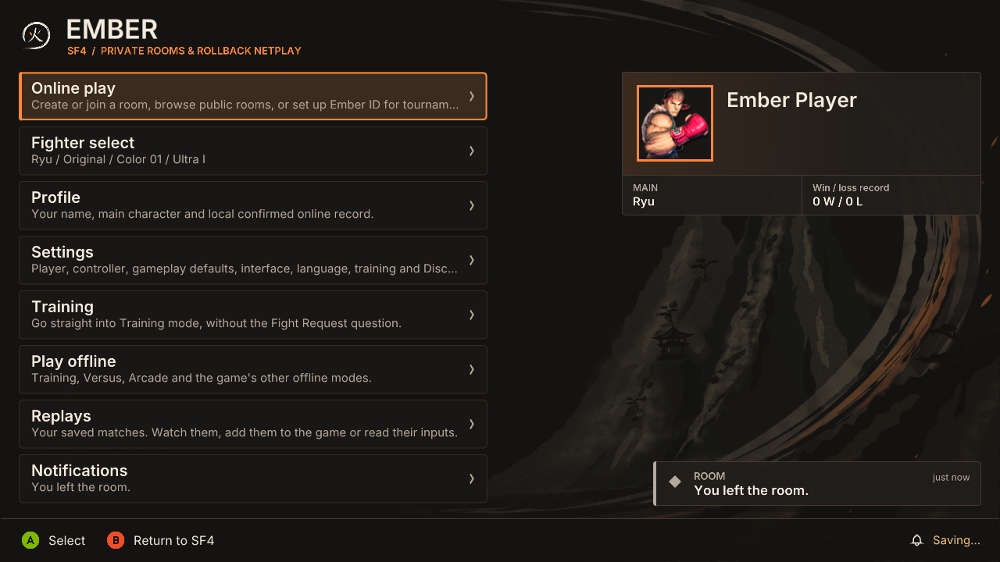
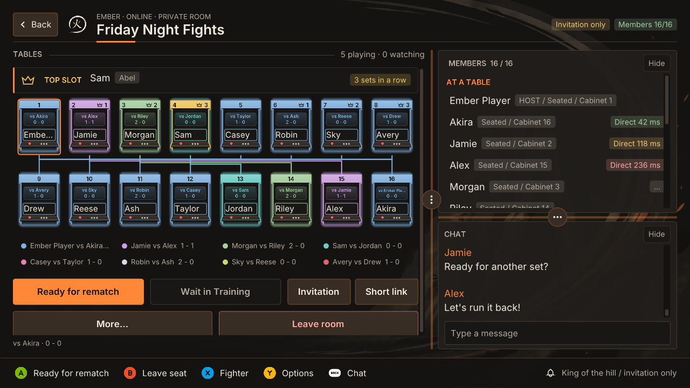
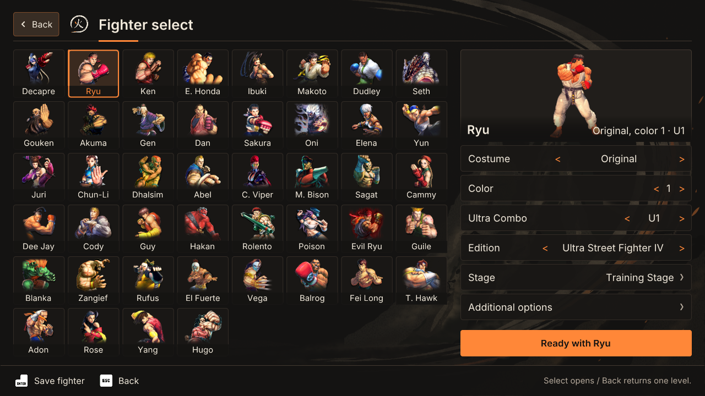
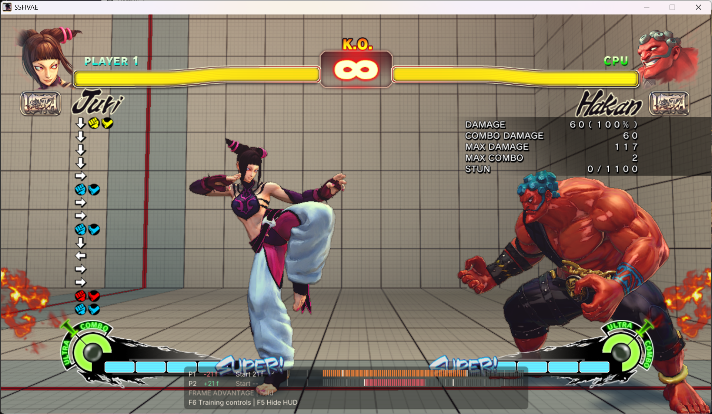

  
  <h1>SF4 Ember Netplay</h1>
  
<strong>Your room. Your rivals. One more game.</strong>

  
Rollback rooms, public rooms and training tools for Ultra Street Fighter IV.

  

    
    
    
    
  

  

    <strong><a href="https://github.com/Confetti3/SF4-Ember-Netplay/releases/download/v1.5.0/sf4-ember-netplay-1.5.0-setup.exe">Download Ember 1.5.0 for Windows</a></strong>
    &nbsp; · &nbsp; <a href="#which-download-do-i-need">Which download?</a>
    &nbsp; · &nbsp; <a href="docs/guides/STEAM_DECK.md">Steam Deck</a>
    &nbsp; · &nbsp; <a href="docs/release-notes/RELEASE_NOTES_v1.5.0.md">What's new</a>
    &nbsp; · &nbsp; <a href="https://discord.gg/uPNqF5A5uq">Discord</a>
  

**SF4 Ember Netplay** adds rollback netplay to the Steam copy of Ultra Street Fighter IV. Make a room and send the link, or drop into a public room and play. Up to 16 people share a room: some play at its tables while the rest queue, watch live and chat. Ember's menus work with a pad, an arcade stick, the keyboard or the mouse.

Ember is free and open source. It is an **unofficial port** of **[sf4e](https://codeberg.org/adanducci/sf4e)** by **Anthony Danducci and contributors**, under the MIT license. Anthony Danducci does not maintain, endorse or support it, and Ember is not affiliated with Capcom or Valve. See [attribution](ATTRIBUTION.md) and [scope and limitations](docs/guides/SCOPE_AND_LIMITATIONS.md).

## Which download do I need?

The [release page](https://github.com/Confetti3/SF4-Ember-Netplay/releases/latest) lists six files. Most people need only one of them:

| You are | Download | Then |
| --- | --- | --- |
| **New to Ember, on Windows** | [`sf4-ember-netplay-1.5.0-setup.exe`](https://github.com/Confetti3/SF4-Ember-Netplay/releases/download/v1.5.0/sf4-ember-netplay-1.5.0-setup.exe) | Install into a new, empty folder. It adds a Start menu entry and an uninstaller. |
| New, and you'd rather not run an installer | [`sf4-ember-netplay-1.5.0.zip`](https://github.com/Confetti3/SF4-Ember-Netplay/releases/download/v1.5.0/sf4-ember-netplay-1.5.0.zip) | Extract everything into a new, writable folder. |
| **Already on Ember 1.4.1** | Nothing | Start Ember. It offers the update at launch and keeps your settings, recordings and replays. |
| On an Ember older than 1.4.1 | The setup.exe above | Run it over your Ember folder. It updates the folder in place. |
| **On a Steam Deck or Linux** | See the guide | [Steam Deck guide](docs/guides/STEAM_DECK.md) or [Linux guide](docs/guides/LINUX.md). Ember runs through Proton. |
| On the old SF4 Netplay Launcher | The setup.exe or zip above | Moving to Ember is a fresh install. Keep the old launcher in its own folder. |

You don't need the other files:

- **`upgrade-…-1.4.1-to-1.5.0.zip`** is what Ember's own updater downloads. You never need to open it yourself.
- **`.sha256` files** are checksums, for checking a download.
- **Source code (zip / tar.gz)**, which GitHub adds to every release, is the code. It is not something you can play.

**Everyone in a room needs the same Ember version, spectators included.** 1.4.1 and 1.5.0 cannot share a room. If a friend can't join you, check that you both show 1.5.0 under **Settings > About**.

### Stable and Nightly

This repository publishes **Stable** releases, the ones linked above. **Nightly** builds, with the newest features before they're finished, come from the separate [Nightly repository](https://github.com/Confetti3/SF4-Ember-Netplay-Nightly/releases). Nightly players can only play rooms with other Nightly players. To switch, choose **Update channel** under **Settings > About** in Ember. Stable is the right choice unless you want to test new features.

## Get started

You need **Windows 10 or later (x64)** and your own **Steam copy of Ultra Street Fighter IV**. The game is not included. You also need the latest **Microsoft Visual C++ x86 runtime**: Ember offers the download if yours is missing or too old.

1. Install Ember as shown in [Which download do I need?](#which-download-do-i-need)
2. Start **Ember** from the Start menu, or run `Launcher.exe` from the folder. The game starts with Ember in it. If Ember can't find the game, it asks for the folder with `SSFIV.exe`.
3. The first time, Ember asks whether to read its menus aloud, which language to use and which controller you'll play with. You can skip this and change it later in **Settings**.
4. Press **F10**, or **Start** at the game's main menu, to open Ember. Go to **Online play**:
   - **Public rooms** lists open rooms. **Quick join** finds a free seat for you.
   - **Create room** makes a private room. Copy its invitation or short link and send it to your friends.
   - **Join room** takes an invitation a friend sent you. A short link opens Ember and joins from your browser.
5. In the room, sit at a free seat, join a table's queue or watch. Choose your fighter, then press **Ready**.

You don't need an account, a VPS or any port forwarding. When two players can't connect directly, Ember goes through a relay. Discord is optional, for invitations and your Discord status. If Windows Defender stops the download, see [Windows Defender](docs/guides/WINDOWS_DEFENDER.md).

You'll find public rooms, rankings and shared replays on the website too: [embernetplay.link/rooms](https://embernetplay.link/rooms), [embernetplay.link/rankings](https://embernetplay.link/rankings) and the [replay archive](https://archive.embernetplay.link/).

## What's inside

| Play together | Make it yours |
| --- | --- |
| Private rooms for up to 16 people, with 1 to 8 tables | Fighter, edition, costume, color and Ultra on one board |
| Public rooms, Quick join, rankings and classes (D to Grand Master) | Player card with your main, flag, title and record |
| Arcade and King of the hill rooms with cabinets | Pads, arcade sticks, keyboard and mouse |
| Sets from first to 1 up to first to 10, and instant rematch | Menus read aloud, TV mode and 14 languages |
| Spectating, room chat and short links | Training with a frame meter, dummy recording and replies |
| Tournaments with Ember ID | A replay library, video export and a public replay archive |

### A room for the whole group

Sit at a table, join its queue or watch the next game. The room host sets the rules for each table, such as rounds, time and set length. After a game, both players can choose to rematch at once without going back to the room. In **Arcade** and **King of the hill** rooms, players sit at cabinets and the winner stays on.

### Choose your fighter

Pick your fighter, edition, costume, color and Ultra on one board, before you join a room or while you wait. Costume previews show each outfit and color before you choose it.

### Frame meter

**Play offline > Training** opens on its own select for your fighter, the dummy and the stage. Inside Training you get a frame meter, frame data, hitboxes, dummy recording and dummy replies. See the [Training lab guide](docs/guides/TRAINING_LAB.md).

The menu pictures above are drawn by Ember's own interface code with made-up sample players. The frame meter picture is from a real game.

### Controls

| Action | Keyboard | Xbox-style pad | DirectInput arcade stick |
| --- | --- | --- | --- |
| Open Ember | F10 | Start (at the game's main menu) | Start |
| Move | Arrow keys | D-pad | Stick |
| Select | Enter | A | Light kick |
| Back | Escape | B | Medium kick |
| Previous / next tab | Page Up / Page Down | LB / RB | Light punch / Heavy punch |
| Change fighter (in a room) | F | X | |
| Table options (in a room) | T | Y | |
| Chat (in a room) | C | View | |

The right mouse button also goes back. You can choose other menu buttons for a stick on its **Button layout** screen. Back from Home hides Ember and keeps you in your room. To leave a room, use **Leave room**. More detail is in the [controller guide](docs/guides/CONTROLLER_MENUS.md).

## Settings and updates

Ember keeps your settings in `%APPDATA%\sf4e`, so they stay through updates. **Settings > About** shows your version and has **Check for updates**, the update channel, attribution and diagnostics. Each update is checked against its SHA-256 before it installs.

**`release` is Ember's current branch.** [Legacy `main`](https://github.com/Confetti3/SF4-Ember-Netplay/tree/c6f2f1907f396c40a8542cc056e3bafa2adb3bde) keeps the old SF4 Netplay Launcher, with its [archived README](docs/archive/README-pre-ember.md). The [branch archive](docs/archive/README.md) keeps retired development branches as tagged snapshots.

## Guides

| Guide | What it covers |
| --- | --- |
| [Player guide](docs/guides/USER_NETPLAY.md) | Hosting, joining, updates and day-to-day play |
| [Ember's menus](docs/guides/V2_MENUS.md) | Home, Settings, the room board and how to move around them |
| [Steam Deck](docs/guides/STEAM_DECK.md) and [Linux](docs/guides/LINUX.md) | Installing through Proton, updating, uninstalling and where the logs are |
| [Training lab](docs/guides/TRAINING_LAB.md) | Frame meter, dummy recording and dummy replies, with a notation cheat sheet |
| [Custom rooms](docs/guides/CUSTOM_ROOMS.md) | Tables, queues, spectators and room rules |
| [Tournaments](docs/guides/TOURNAMENT_MODE.md) | Ember ID and playing organized tournaments |
| [Accessibility](docs/guides/ACCESSIBILITY.md) | Speech, TV mode and the accessibility button |
| [Input lag](docs/guides/INPUT_LAG.md) | Input delay and the game's own settings |
| [Discord](docs/guides/DISCORD.md) | Invitations, your Discord status and privacy |
| [Troubleshooting](docs/guides/TROUBLESHOOTING.md) | Startup, connections and diagnostics |
| [Saving logs](docs/guides/SAVING_LOGS.md) | Saving logs from both players for a bug report |
| [Windows Defender](docs/guides/WINDOWS_DEFENDER.md) | When antivirus flags Ember |
| [Build and package](docs/development/BUILDING.md) | Building Ember yourself |
| [Server](server/README.md) | The Ember server: bridge, public rooms, short links and hosting |
| [All documentation](docs/README.md) | Design notes, test results, reports and release notes |

Ember is still experimental. Read the [limitations](docs/guides/SCOPE_AND_LIMITATIONS.md) before you play.

## Community

Find opponents, organise sets and get help in the [Ember Discord](https://discord.gg/uPNqF5A5uq). You can also open it from the in-game menu under Help & About. Report bugs in [Issues](https://github.com/Confetti3/SF4-Ember-Netplay/issues) so they are not lost.

## License and credits

This project is under the [MIT license](LICENSE), which carries both the SF4 Ember Netplay contributors copyright and the upstream copyright with **Anthony Danducci's sf4e** attribution. Anyone reusing code from this port must keep both notices; see [using code from this port](ATTRIBUTION.md#using-code-from-this-port). [ATTRIBUTION.md](ATTRIBUTION.md) records upstream, dependency, font and artwork credits. Packages include dependency notices (with the Unicode License V3 for the Unicode data used in report redaction), Inter's OFL and Kenney's input-prompt license. Capcom game imagery is separate from the source-code license.

## External Licenses and Copyright Information

Street Fighter, Street Fighter 4, Ultra Street Fighter 4, and all related software
Copyright (c) CAPCOM.

Steam
Copyright (c) Valve Corporation.

Visual Studio, vcpkg, and Detours
Copyright (c) Microsoft Corporation.

CMake - Cross Platform Makefile Generator
Copyright (c) Kitware, Inc. and Contributors.

Dear Imgui
Copyright (c) Omar Cornut

spdlog
Copyright (c) 2016 Gabi Melman.

nlohmann/json
Copyright (c) 2013-2022 Niels Lohmann

GGPO (Good Game Peace Out)
Copyright (c) GroundStorm Studios, LLC.
