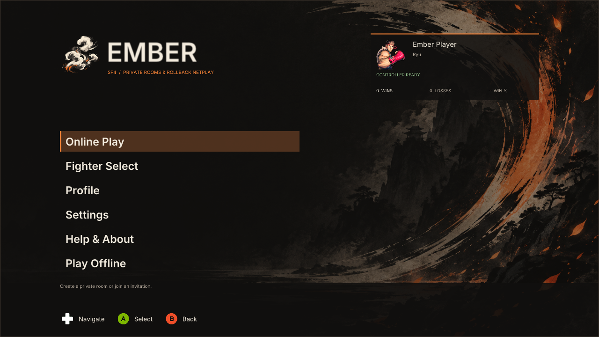
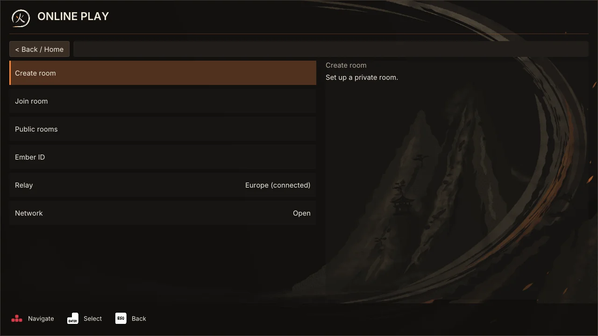
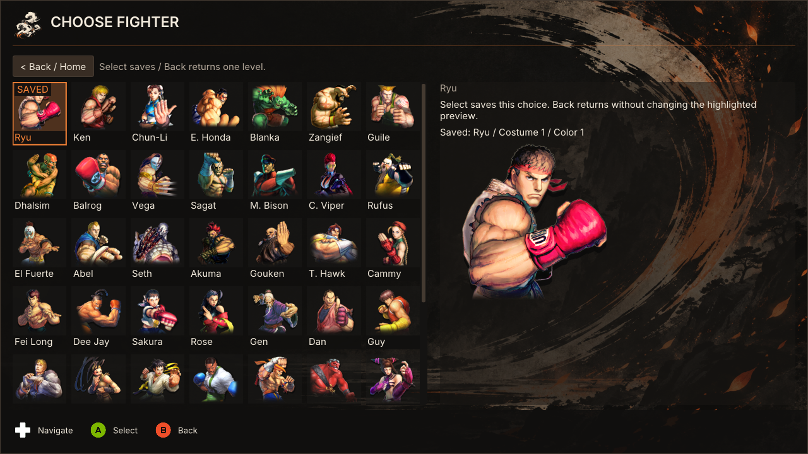
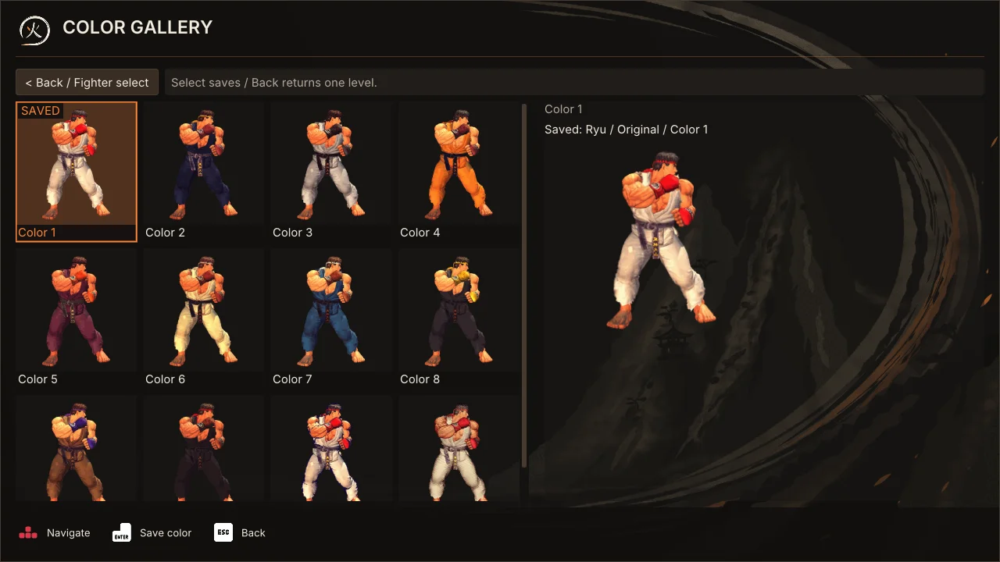
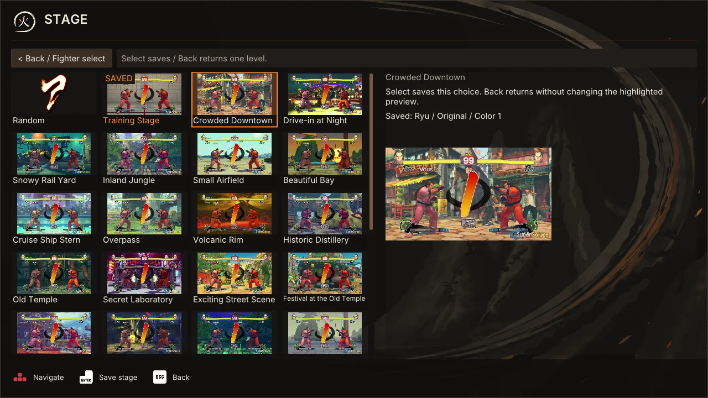
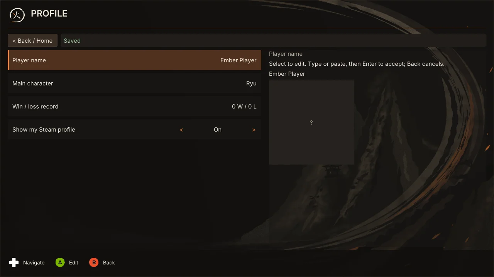
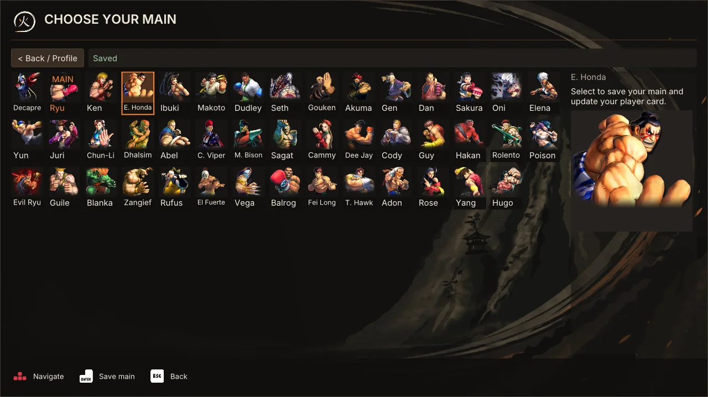
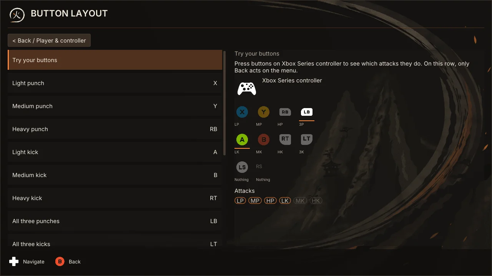
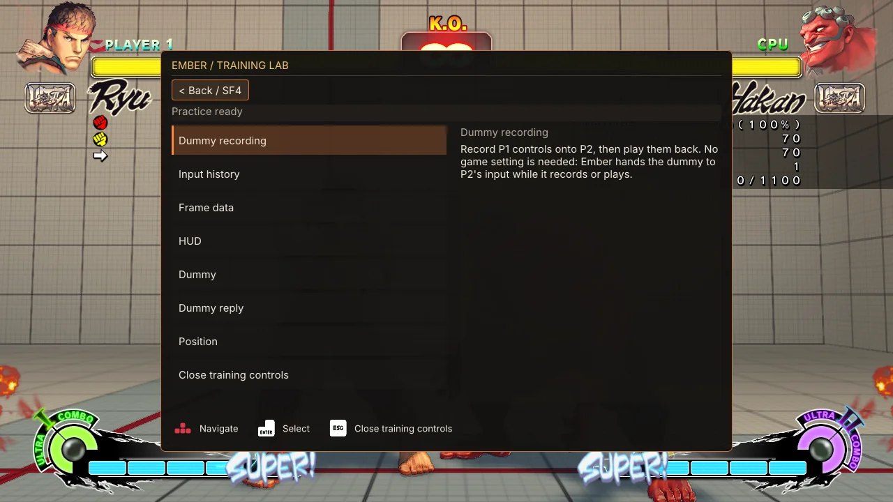

# Ember controller-first menus

Ember's menus cover Home, rooms, fighter selection, settings and offline training.

## Navigate

Press F10 or Start at the native main menu to open Ember, or during a game you fight in a Practice room, where it opens on End practice (see [Training with another player](TRAINING_LAB.md#training-with-another-player)), or during a game you watch, where it opens on Stop watching (Leave this game for a queued member) and is translucent over the fight. Ember's menus select with the bottom face button and go back with the right one (A and B on Xbox) on an XInput controller, which every controller you set up in Ember is, whatever your fighting buttons are. On a DirectInput stick the game reads itself they use the buttons SF4's own menus use, its Light Kick and Medium Kick buttons, shown as LK and MK because its physical labels are not identifiable, and moving LK and MK in Game's button settings moves them in Ember's menus too. To use other buttons in Ember's menus only, choose Menu confirm and Menu back on the controller's Button layout screen and press the button you want; the two cannot share a button, and Start, View and the D-pad keep their jobs. Use the game's layout on that screen returns them to the bottom and right face buttons. DirectInput sticks the game reads itself have no shortcut buttons. On an XInput controller in a room, X, Y and View are shortcuts (see Play online). D-pad or keyboard arrows move the highlight; Left/Right adjusts value rows. Lists and grids stop at their edges. Direction holds repeat, but actions and confirmations do not.

Back cancels the current text draft, confirmation or open choice first, otherwise returns one level. On the room board, Back goes to Home and keeps your seat or queue place. Use the card's explicit Leave choice to give it up. Back from Home hides Ember and returns to the game without leaving your room, and Home's Online play row returns to it. Use the explicit Leave room action to disconnect; its confirmation starts on Cancel.

Select a text row before typing or pasting with a physical keyboard. Enter accepts the draft; Escape or controller Back discards it. Chat is the exception: its message box is already open when the screen opens, so you just type and press Enter to send. Moving the mouse pointer moves the highlight over menu rows, dialog options and the seat chooser, while a resting pointer never undoes what the pad just chose; clicking selects. Click either end of a value row to adjust it with a mouse.

## Play online

Choose Online Play, then Create Room or Join Room. Create retains populated defaults. Join prioritizes Paste Invitation and Join. While connected, Online Play returns to your room.

The room overview follows SF6's Custom Room composition: four stacked battle slots on the left, members above chat on the right, and the room's actions (Members, Chat, Table options, Room settings, Copy invitation, Leave room) sharing the right column beneath them, with the focused entry's explanation on a line below. Right moves from a slot to the member pane; Left returns to the last focused slot. Up/Down visits entries in order. Narrow layouts stack the same entries in one scrolling list.

Select a slot with A. With no seat or queue place, it opens the seat chooser: Play as P1 or Play as P2 for an open seat (an empty table offers both), otherwise Join queue; then Watch; and Table options. The D-pad or mouse pointer picks, A confirms and B cancels. On your own seat, A opens Ready, Fighter, Leave seat and Table options choices. Ready takes Ready back when already readied. A queued player's card offers Table options and Leave queue. Leave asks first when it would end a set score or hand the seat to a queued member, with Cancel selected. A blocked choice explains why it cannot act. During a held start, Cancel the start takes Ready back. Back closes the choices and otherwise returns Home without giving up your place. On an Xbox pad, X opens Change fighter, Y opens Table options (the focused table's, otherwise your own) and View opens Chat; on the keyboard F, T and C do the same. On the keyboard Escape always goes back, even on your own card, and Delete leaves your seat or queue place. Pressing the same button again returns to its opener, and all three work from every room screen, including fighter selection.

Player cards use native SF4 portraits. If the game's portrait cannot be loaded, the packaged original-outfit picture stands in where one exists. The Random stage card reads the game's character-select random tile at runtime and shows the usual preview-unavailable placeholder when that tile cannot be read. The members pane and Home profile card show each player's saved main, independently of battle selection. The main is validated and shared during room admission, including for spectators. Battle-slot portraits still show the current match fighter after the pre-battle exchange. Older snapshots without optional profile metadata show an unknown portrait instead of guessing from the match fighter. Portrait metadata does not change selection or readiness.

Members, room rules and host administration retain separate action menus. Chat (View, or C) shows the whole conversation, oldest at the top, with your own messages marked You and a line for each member joining or leaving, a new host and a finished game or set. Typing needs a keyboard: Enter sends, and the draft stays in the box, when you leave the screen too, until the room shows your message. Up and Down (or Page Up and Page Down) scroll; Escape or B goes back. While you type, F, T and C are letters, so the keyboard shortcuts wait until you leave the box. Messages from other members that arrive while you are elsewhere show as a count on the Chat row and above Recent chat until its newest message is visible in focused Chat or an attended room chat panel; your own and muted members' messages never count. Table options (Y) opens Battle setup for a table: both players' Ready status stays visible. Change fighter (X) opens the roster at your fighter; picking one goes on to its Ultra, and picking the Ultra returns to the room. Then select Ready on your card. Ready requires both seats, a connected assigned input device, valid choices and a healthy room. Missing requirements appear in the detail panel. Ready locks fighter changes; Unready / unlock fighter cancels Ready before the match begins. Rematch uses the saved selection. Host-only actions remain unavailable to other members, with an explanation. Battle setup has, in order: Ready, Change fighter, Ultra Combo (Left and Right step it), Input delay (Left and Right choose 0 to 5 frames or, below 0, Auto; Select applies the recommendation; the detail names the recommended and match delays), Check connection, then the table's rules. The host edits Rounds, Round time and Edition Select there and presses Apply rules; others see the rules on one line. Both fighters play at the higher of their two delays. See [custom rooms](CUSTOM_ROOMS.md).

The room board also has a message field in Classic and V2. Select it to type; Enter or controller Select sends once, and Back releases the field without discarding the draft. X, Y and View still open their room screens while the field is active. Chat history shares that draft. Changing or leaving the room clears it. Scrolling away from the newest message, hiding the overlay or switching applications does not mark it read.

Discord invitations use the same pending, cancellation and confirmed room-switch flow. Cancel does not leave your current room. Live table/member updates preserve focus by identity, and stale destructive confirmations are discarded.

## Choose a fighter

The arcade roster previews the highlighted fighter. Select commits it; merely moving the highlight does not. Saved choices are marked. Appearance opens separate Costume gallery and Color gallery pages with individual artwork cards. Move to preview, Select to save, then Back to return. Choices use native availability rather than asset counts. Ultra, Stage and additional options remain separate; P1 retains stage authority.

## Change settings

Home also includes Profile:

1. On Home, choose **Profile**.

   

2. Select **Player name** to edit your name, or **Main character** to choose a main from the portrait roster: press A on Xbox (or click a portrait), then wait for Saving to finish.

   

After the settings update is accepted, the menu returns to Profile and names the saved portrait. A failure stays visible with Retry. Merely highlighting a portrait does not save it. Your saved main supplies the player-card photo and name; it does not overwrite your next match's fighter. The card shows local confirmed online wins, losses and win percentage. Tracking started with v0.8.0, is local to this settings profile, and excludes offline/training, spectating, draws, cancellations, disconnects and unresolved results. It is not a Steam rank or historical record import. A native result must agree with the room's confirmed result, and repeated notifications are deduplicated. The profile persists through the existing asynchronous settings writer. Your name, main and personal settings cannot be changed while you are in a room; leave the room first.

Prompts name the buttons that select and go back: A and B by default on XInput, or the buttons you chose for Menu confirm and Menu back. None of this rewrites your SF4 attack mappings or the game's own menus. DirectInput uses a generic button sprite with LK/MK labels instead of guessing another controller's labels. The launcher's recovery window, which runs before the game, keeps buttons 1 and 2 on a stick and says so in its prompts; it does not follow the game's tables or your Menu confirm and Menu back. While you set up a controller's buttons, the summary selects with the button you just recorded as Light kick and goes back with Medium kick, and its prompts name those buttons, until you save. Controller, direction and keyboard sprites are unmodified assets from Kenney Input Prompts 1.5A (CC0), not custom-drawn shapes or font-dependent Unicode symbols.

Player & Controller, Gameplay Defaults, Interface and Discord use named value rows. Valid personal changes are coalesced and saved asynchronously. Saving/Saved/Error feedback is quiet; Retry saving resubmits after failure. Room rules still require Apply and host authority.

Ember automatically adopts SF4's connected controller, or the sole connected controller when the native menu still points to keyboard. Multiple unassigned controllers trigger release-all / press / release capture; simultaneous presses cannot choose an arbitrary device. With no controller, keyboard is provisional until explicitly chosen or used to join a room. You can explicitly choose a device under Player & Controller. Disconnecting never silently replaces an established device.

Before starting a match, Ember rechecks the device and verifies native P1/P2 binding. Each local GGPO input sample is read only while that binding and device identity still match. A disconnect, replacement, or changed native slot produces neutral input and a visible warning, never another controller's buttons. Reconnect the original device; if its slot changed, return to the room to reassign it. These checks use SF4's native type, index and device name; they cannot prove physical hardware identity when identical devices are re-enumerated under the same slot/name.

## Practice

In offline training, F6 opens and closes Ember's training controls from the keyboard. On the assigned pad, hold Back and press Start within half a second to do the same: View and Start on an Xbox pad, Select and Start on a DirectInput pad, whose physical Back and Start the game normalizes to the same buttons. Inside, the pad works as in the other menus: the D-pad moves, the menu buttons select and go back (A and B on an Xbox pad, LK and MK on a DirectInput pad, unless you chose others), Left and Right change values, and B at the root closes the controls. Keyboard arrows, Enter and Escape, and the mouse, work too. The legend and the training HUD's chips show the buttons of whichever device was used last. Typing a recording's name or reply moves needs a keyboard.

The chord takes nothing from the pad's other uses. Start pressed on its own still opens only the game's pause, and Back alone still resets the position on a tap and saves it on a half-second hold. Start counts only when Back is already held, a Back used for the chord neither resets nor saves (a Start later than half a second comes after the save), and the chord's Start never reaches the game, so it does not pause it. An open flyout captures gameplay input everywhere, including controllers. Held closing buttons must return to neutral before gameplay resumes.

The controls hold Dummy recording, Input history, Frame data, Dummy, Dummy reply and Position. Dummy Recording has eight slots, playback, loop and clear, and saves and loads recordings by name; Input History exposes each player's runs; Frame data gives each fighter's last move, the colour key, the meter's style and how many frames it shows (the HUD page holds Meter settings); Position saves and resets the fighters, on two keys of your choice. Occupied recording overwrite and clearing require confirmation. Record and Play close Ember only after the game thread accepts the command. Failure stays on screen. Opening the controls stops standby, a recording and a playback. Close native pause separately before practice resumes.

F5 toggles the passive training meter, F6 the controls, F7 standby, record and stop, and F8 play and stop. F2 resets and F11 saves the position until moved on the Position page. F7 opens the recording menu for confirmation when a slot is occupied. See [Training lab](TRAINING_LAB.md).

When a room calls you back from Training, the banner offers Go now: Enter, or View on an Xbox pad, leaves at once instead of after its two seconds. That View press only goes now; it does not also reset or save the position. During the call Back and Start do not open the training controls, and that Start does not pause the game. Other pads are shown Enter, and their Select still resets and saves.

## The V2 look

Settings > Interface > Look switches between Classic and V2 (preview). V2 changes only how the screens look: every row and shortcut above works the same. What V2 adds:

- Tabs, such as Settings' six: LB and RB step them, Page Up and Page Down on the keyboard; with the mouse, click a tab or the LB and RB marks at the strip's ends.
- The header's Back button and the right mouse button both go back, as B and Escape do. Back first closes an open panel, popout or question.
- Settings panels: A, Enter or a click opens the panel on the left; B, Escape or a right click closes it.
- Values: A or Enter flips a switch; Left and Right, or a click on an arrow, step a number; A or Enter opens a choice's panel with every choice, and B keeps the old one.
- Popouts: a room member's actions and the room's More… open beside the row, or where you clicked. B, Escape or a right click closes them.
- The on-screen keyboard: with a pad, a text row opens a keyboard. The D-pad moves, A types, X deletes, Y adds a space, LB switches capitals, Start is Done and B cancels.
- Toasts: a new toast with buttons takes the focus. A or Enter takes its first button, B or Escape its Later, and any other press goes on as usual.

See [V2 menus](V2_MENUS.md) for every V2 screen with pictures.

## Runtime acceptance checklist

These checks require your physical controllers and a running game; synthetic tests are not substitutes:

- XInput: A selects and B returns even with an Ember button layout; after moving LK and MK in Game's button settings, Ember's menus keep A and B (a stick the game reads follows); after binding Menu confirm and Menu back, those buttons act and the prompts name them. X, Y and View never activate a menu row unless bound to one, and otherwise only open Change fighter, Table options and Chat inside a room. DirectInput selects on LK and goes back on MK. Check release/open, directional repeat, focus restoration, disconnect/reconnect and explicit reassignment.
- Native main menu: no cursor movement, selection or Back action underneath the visible overlay; no held close-button leak on return.
- Training: Start alone opens only native pause, and Back alone resets on a tap and saves on a hold. Back held, then Start, opens and closes the controls without pausing, resetting or saving, on XInput and DirectInput. Inside, the D-pad, the menu buttons (A/B, LK/MK on DirectInput, or your bound ones) and Left/Right work, and the legend and HUD chips follow the last device. F6 and keyboard arrows/Enter/Escape still work.
- Training isolation: navigation, by keys or pad, never moves fighters or enters recordings; a recording or playback starts only from a command, never from navigation.
- Rooms: create/join, seat chooser, queue/watch and Lock in to watch, Ready/Unready/rematch, explicit Leave seat or Leave queue, Back preserving the seat, host rules, stale/rejected commands, safe leave, Discord cancellation/switching and two-PC play.
- Settings: rapid changes coalesce, failed persistence displays Retry, and a restart reloads accepted settings.
- Match input: test the same controller as both P1 and P2, after rematches, and after disconnect/reconnect. Press a second controller to confirm it cannot control the local fighter. Check the warning on a changed native device slot.

## Local evidence and rebuild

`ControllerNavigationTest` exercises the renderer's shared semantic model and shell/training journeys. `UiRenderTest` renders all redesigned screens across ten viewport/DPI configurations, including 1920x1080 at 150%, and can decode the installed game's artwork without launching it. Its row-text probe caught 35-pixel Home text being drawn into a 24-pixel padded interior. Rows now reserve space from their actual font metrics, and the extra heading scale was removed. The test checks this on every standard menu row and verifies that all four battle slots fit at standard landscape sizes. The native input analysis is recorded in `2026-09-08_reverse-USF4-menu-input-report.md`; the visual references are in `SF6_ROOM_REFERENCE.md`.

Build only with `scripts/build-current.ps1`. Package only from `build/current` and `build/current/stage`, using `scripts/package-team.ps1`. The parent workspace's `verify-current-package.ps1` checks the source fingerprint, receipt, staged/package binaries and ZIP contents. Other historical checkouts are not release targets.

Room shortcuts preserve their opener. Pressing the same shortcut again returns there; revisiting a page already on the path unwinds to it without building a navigation loop. A Training call opens the player's table through Home and Room.
