# Private custom rooms

A room supports up to 16 members and four independent versus tables. A member can
play or watch one table at a time, or remain idle after joining. Each table can
hold two fighters and up to 14 spectators. Everyone must use the same Ember
release.

## Open a room

1. Start the game through the launcher, wait for networking to become ready,
   and assign your gameplay controller.

   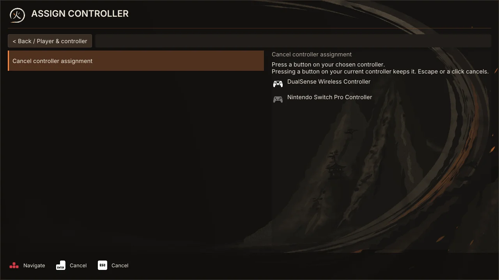

2. At the main menu, open **Online play > Create room**, choose the room name,
   capacity, and default battle rules, then select **Create room** again.

   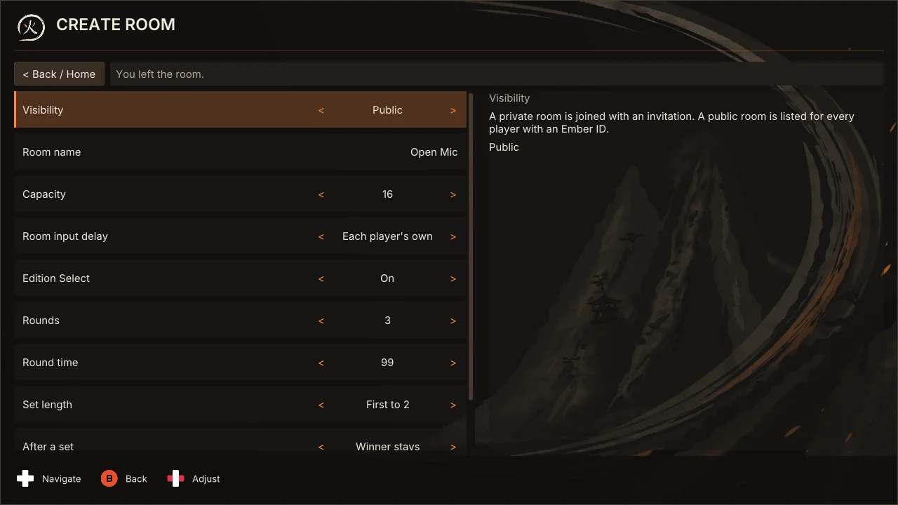

3. Use **Copy invitation** to share the private invitation with your players.

   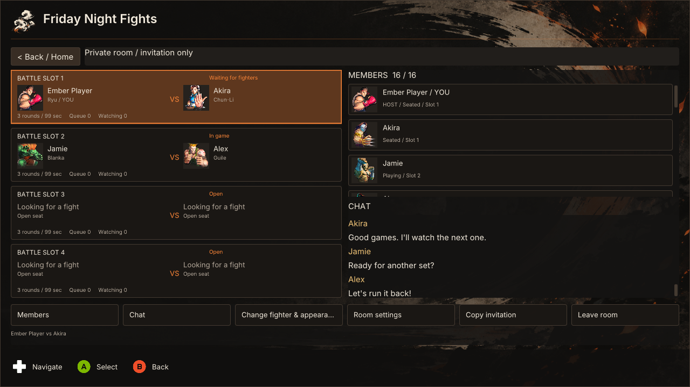

4. Guests open **Online play > Join room**, select **Paste invitation**, then
   **Join room**. Joining a room leaves them idle until they explicitly choose a
   table and take a seat, queue or watch.

   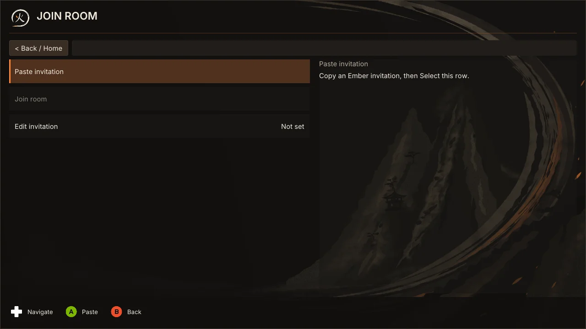

   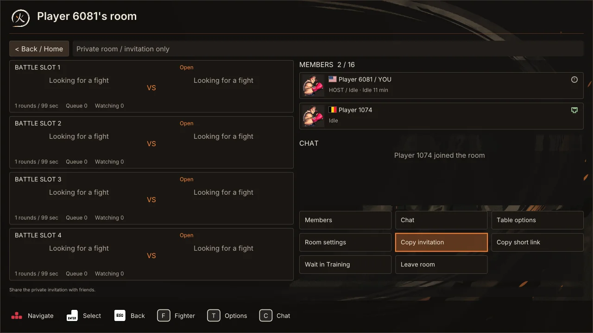

While the room opens, the row reads **Stop creating** or **Stop joining**. If
it has not opened after about 30 seconds, Ember says so; check your connection,
or stop and try again. A room that is still opening is not in recovery and
offers no Replace room.

The host manages the room independently of the P1 seat. The host may stay idle,
play at any table, or watch.

## Play and rematch

Select a table's card. With no seat or queue place yet, it opens a seat chooser:
**Play as P1** or **Play as P2** while that seat is open and nobody is queued
ahead (an empty table offers both seats), otherwise **Join queue**; then
**Watch**; and **Table options**. Open seats fill in queue order. If you already
hold a seat or queue place at another table, the card opens that table's Table
options instead, and joining there waits until you leave your current place.
Seated fighters choose their characters and both select **Ready up** (A on your
own card) before each game. Before preparation begins, a fighter can withdraw
readiness with **Unready / unlock fighter**.

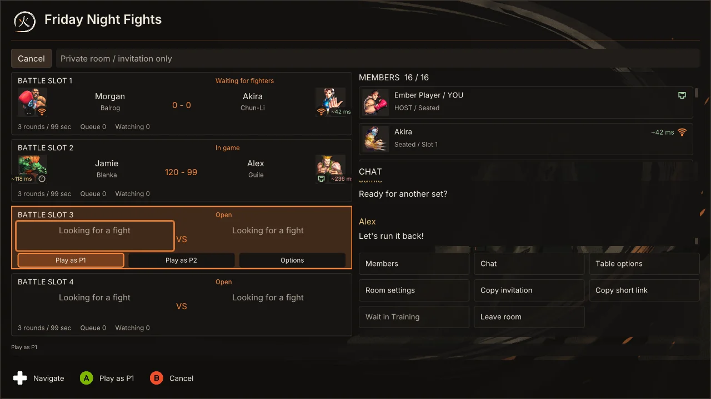

Battle setup, opened from **Table options** (Y on an Xbox pad, T on the
keyboard), starts with Ready, then your **Change fighter** and **Ultra Combo**
(Left and Right step the Ultra in place), then **Input delay**. Its value is
your own delay, and its detail names the recommended delay and the match delay.
A new profile is on **Auto**: the connection check runs by itself for each
new opponent, and a Ready pressed meanwhile waits for it to end, for about
twelve seconds at most. A check that fails is tried once more. You ready with
its recommendation held between one and three frames, or with two frames if it
produced none. A rematch, or a change of fighter, keeps the measurement, and
after each game Auto follows the ping that game reported, up or down, by the
same bands as below, when the game gave at least ten seconds of it; spectators
and the queue are never checked or held. **Check
connection** runs the same five-second measurement by hand. Left and Right
choose a delay of your own instead, from zero to five, with Auto one step below
zero. Zero adds no delay and needs a steady, low ping; Auto and the
recommendation never choose it. A chosen delay is saved, Select applies a valid recommendation to it,
and you can Ready without a usable probe. Ready locks your own delay for that
game; Unready unlocks it. A route change or a new
recommendation never changes delay during a fight. The table's rules follow on
the same page: the host changes Rounds, Round time and Edition Select in place
and presses **Apply rules**, which appears once something changed; everyone
else sees them on one line.

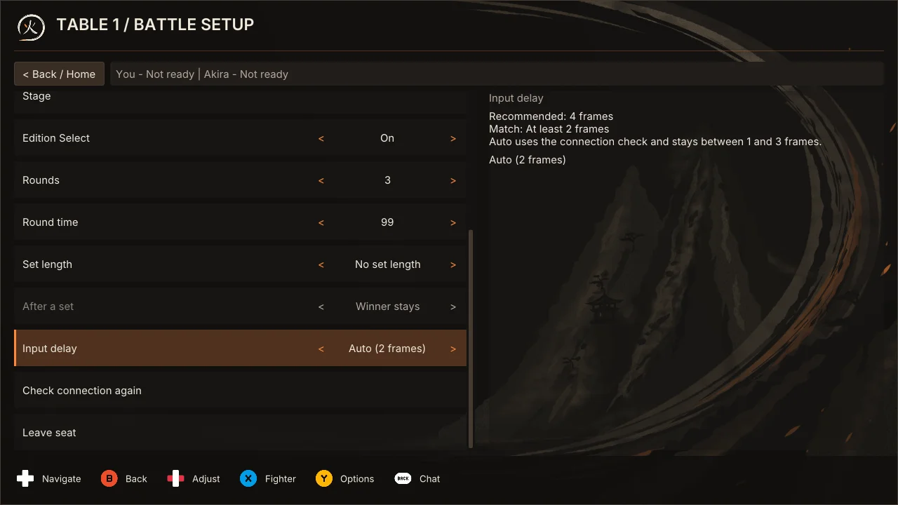

Both fighters play each game at the higher of their two Ready delays. A
fighter's delay decides how much rollback the other fighter sees, so separate
values favored the fighter who chose less. Input delay's detail shows the
match delay in use; before your opponent readies it shows "At least" your own
choice. Each fighter's own delay is kept for the next game.

The room can choose otherwise when it is created. **Room input delay** on
Create (private or public) is **Same for both** to begin with, as above. With
**Each player's own** every fighter plays at the delay they readied with, and
the other side's rollback makes up the difference; Input delay's detail then
reads "Your delay" instead of the match delay. The choice is kept with the room
defaults, is fixed for as long as the room is open, and shows as "Own delay" in
the room's rules and on its table cards and, for a public room, in the list.

Advice requires at least 80 valid replies out of 100 probes from the current
connection and path. It follows the median round-trip time, the ping the check
shows: up to 80 ms is one frame, 81 to 150 ms two, 151 to 220 ms three, 221 to 290 ms four, and
291 ms and up five, the most it recommends.
If the 95th percentile round trip lands more than one step worse than the
median's, the recommendation rises to one step below it. These are tuning
assumptions, not a guarantee about frame timing or network quality.

Each table has a **Set length** and, once it has one, an **After a set** rule.
The host sets both with the other table rules. With no set length the same two
fighters keep playing until one of them leaves, and results count their wins
against each other. With a set length of first to 1 through 10, the set ends
when a fighter reaches that many wins and the seats rotate:

- **Winner stays** (king of the hill): the winner keeps the seat and the loser
  goes to the back of the queue.
- **Loser stays**: the loser keeps the seat and the winner goes to the back.
- **Both rotate**: both go to the back of the queue, winner first, and the next
  two sit down.

Only members who chose **Join queue** are ever given a seat. Watching a table
never puts anyone in its queue, and a fighter rotated out can leave the queue
at any time to just watch. When nobody is waiting, the same two start a new set.
A fighter who wins two or more sets in a row at the table has the streak shown
under their name. Changing the set length or rotation starts a new set; the
other rules apply from the next game and keep the score.

The running count, such as 2 - 1, replaces "VS" on the table card and "vs" on
the match HUD, and the HUD keeps the final count on the screen of the game that
ended the set. Both fighters must ready again after returning to the room. When
a fighter leaves their seat, the next queued member takes that seat and the new
pair starts with fresh win counts. B on your own table card, or
**Leave seat** in the table options, leaves your seat at once. It asks first
only when the pair has wins on the board or a queued member would take the seat;
the question starts on staying. A game in progress or an unresolved result holds
the seat, and B says why. While a start is held for a locked-in spectator, B
cancels the start by taking Ready back. An unresolved game does not award a win or erase earlier
wins for the same pair.

Queued members automatically watch each game while retaining their queue
positions. B on your queue card, or **Leave queue**, leaves the queue at once.
Leaving the queue during a game lets you finish watching it; the place ends with
that game unless you press **Watch next game**. Between games, leaving the queue
returns you to the room. A queued member has no Watch or Stop watching action of
its own; during a game, Start or F10 opens Ember over it, where **Leave this
game** stops watching that game and keeps the queue place.

## Watch

**Watch next game** (**Watch** in the seat chooser) reserves a spectator place
without joining the queue. A game already in progress cannot be joined halfway
through. **Stop watching** returns the spectator to the room; the fighters
continue playing. During a game, Start or F10 opens Ember over it on the room
board at **Stop watching**; Queue, Watch, Leave queue and Leave room there say what
happens to the view. Your view runs a little behind the room, so the room may
have finished the game while you still watch it: Stop watching then only ends
the rest of the view, and your place at the table stays as it is.

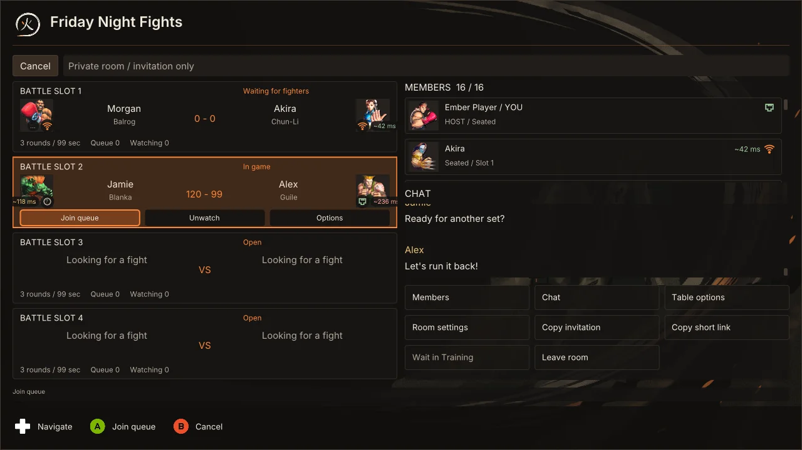

A spectator by choice can also use **Lock in to watch** in Table options
(**Release lock-in** undoes it). If both fighters ready while a locked-in
spectator is still leaving the last game, the start waits for them for up to 10
seconds, then goes ahead regardless. The table reads "Waiting for spectators",
and its card names who the start waits for and counts down ("Waiting for Alex
to return. Starts in 7 s."); the spectator it waits for is told the game is
waiting for them. Either fighter can take Ready back during the wait with
Unready or Cancel the start, and then the game does not start. Without lock-in
the fighters do not wait: a spectator still closing out the previous game joins
the game after that. Lock-in ends when you stop watching, move to another table
or seat, or your view of a game fails, so it cannot hold up the fighters again;
a short notice says which. Only your own Release lock-in, while you keep
watching the same table, ends it without one.

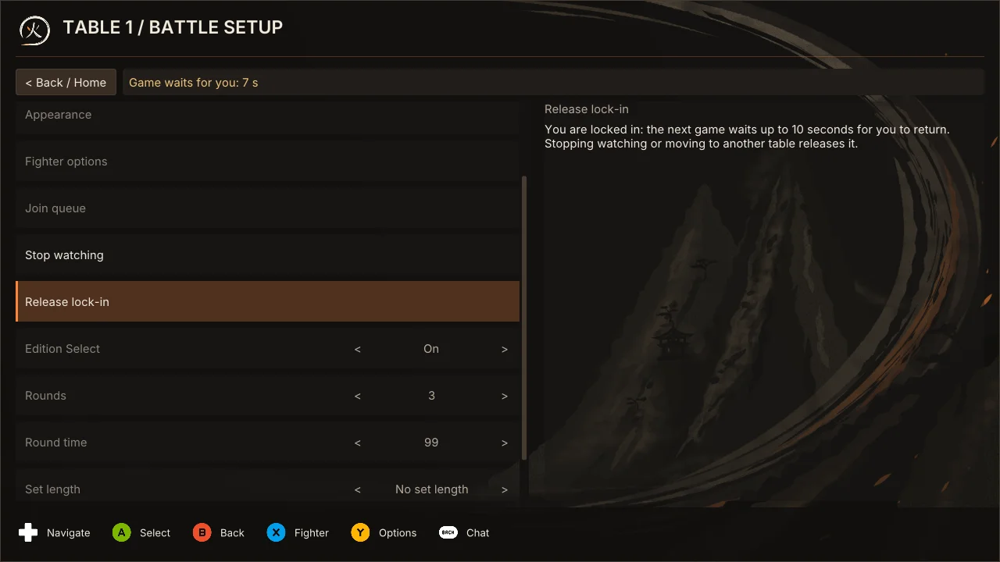

A spectator whose connection is still being set up when the fighters are ready
(after a short grace period) misses that game and watches the next one. A
spectator that was away from the main menu when the game started is told so and
watches the next one. A spectator whose connection leaves about half a second of
network frames unacknowledged, sustained for about a second, is dropped from that
game, keeps its place and watches the next game at the table; it is told so.
Slow playback alone does not drop anyone: the spectator plays
extra frames to catch up and can trail by up to 1024 frames (about 17 seconds).

## Manage the room

The host can rename the room, lock admission and change its capacity in **Room
settings** on the room board, edit a waiting table's battle rules, and kick
members. Capacity cannot be reduced below current membership. A kicked peer
cannot rejoin the same room under another name.

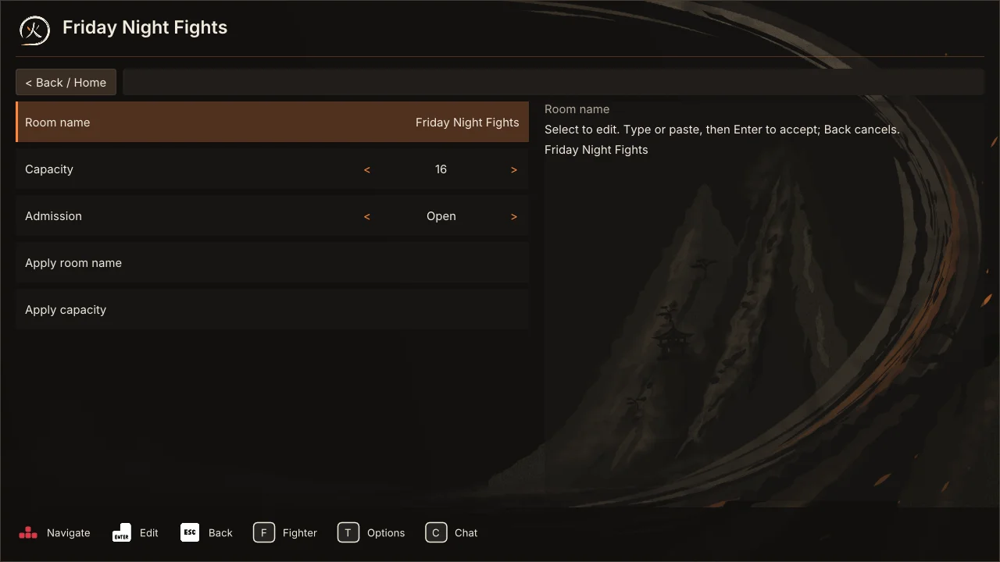

Room chat retains the latest 100 messages, with a limit of 256 UTF-8 bytes per
message. The room removes a member's messages when they leave, but your own Chat screen keeps the messages it has already received (the latest 200 lines, with the room's join, leave, host and result lines among them) under the name the member had. **Mute member** hides that member's messages on your screen only.

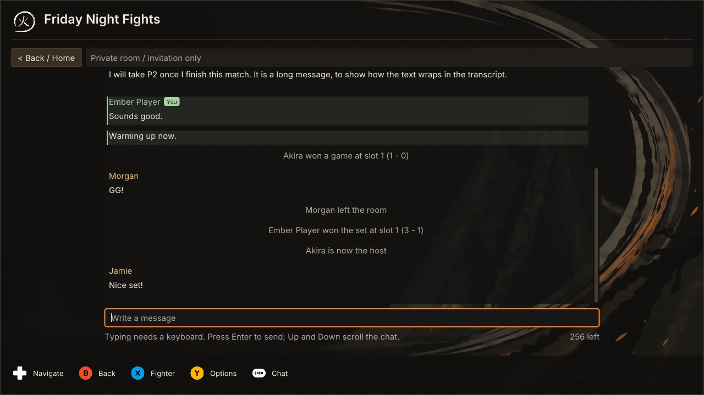

Both fighters report the game's native outcome. A win is counted only when the
reports agree. Conflicting reports, or missing reports after the result deadline,
leave the game unresolved. The host can **Cancel unresolved game** to allow the
fighters to ready again without awarding a win or removing previously counted
wins. This keeps a disagreement from becoming an automatic result.

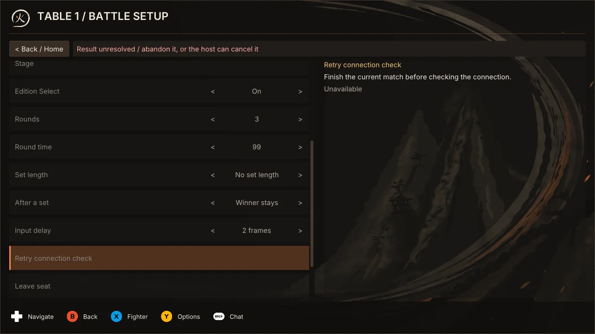

To hand the room to another member:

1. Open **Members** and select the member.

   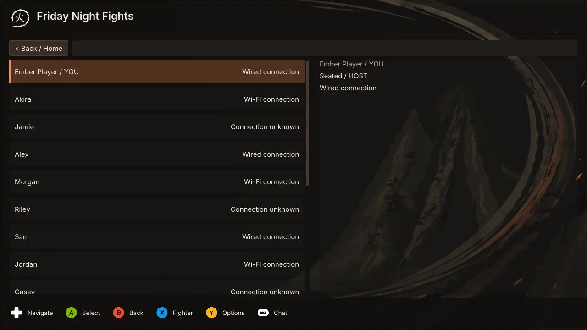

2. Choose **Transfer host** and confirm; the question starts on Cancel.

   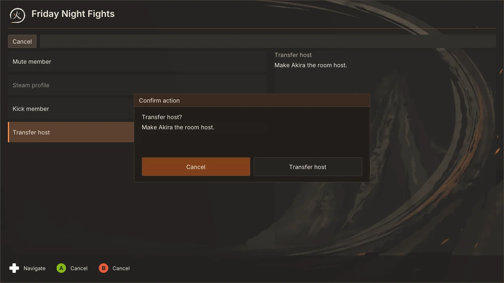

Normal host departure transfers moderation to the oldest eligible remaining
member. The room's technical coordination leader is separate from that moderation role.

## Recover room control

Room mutations pause immediately when coordination becomes unavailable. A
healthy game can continue on its existing gameplay connection while room
control reconnects. Native results wait for committed matching fighter reports;
the result deadline pauses while room control is recovering.

After 15 seconds, **Replace room** is offered. It remains unavailable while
local gameplay owns its sockets. If preparation is incomplete, selecting it
explicitly cancels preparation and waits for its local connections to close.
It then opens a fresh room with new invitations and authority. Saved preferences and
local records remain. The confirmation defaults to Cancel, and recovery of the
old room continues while you decide.

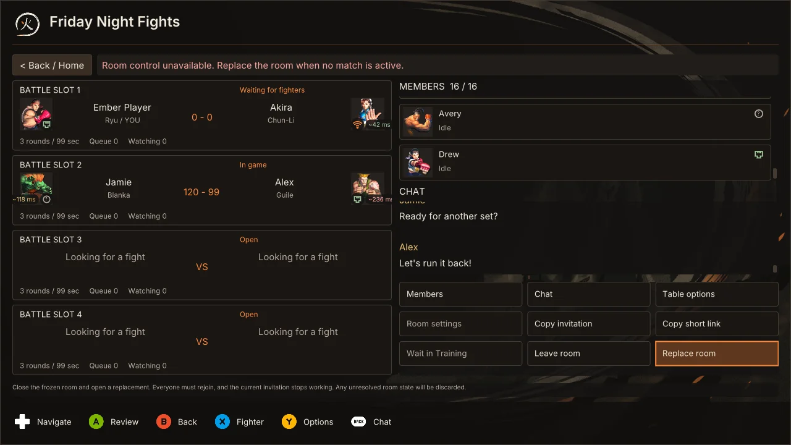

A two-member room needs both voters. Unexpected loss of either member cannot
recover the old quorum; use the replacement action after gameplay has retired.
Larger rooms can recover when their existing voter majority is available.
The minority never recreates the old room.

New room invitations use `sf4e3:` and Discord invitations use compact `emd2:`
secrets. Copy a fresh invitation after an authority change; old authority
references and expired invitations are rejected.

## The room in the V2 look

With Settings > Interface > Look set to V2, the room is one board: tables on
the left, members and chat on the right, and Ready up, Wait in Training,
Controllers, More… and Leave room along the bottom. A table card has its own
Ready up and Leave seat buttons. Members are grouped as Playing, At a table,
Watching and In the room, each with a ping such as Direct 46 ms or Relay
59 ms.

- **Member actions:** select a member with A (Enter, or a click). Mute
  member, Steam profile and, for the host, Kick member and Transfer host open
  as a popout. Kick and Transfer host still ask first.
- **More…** holds Table options, Room settings and the invitation links.
- **Layout:** drag the grip on the line between the tables and the right
  column to change the column's width, and the grip between members and chat
  to share the column. With a pad or the keyboard, use Settings > Interface >
  Room layout: Column width, Members and chat, Ready-made layout and Restore
  defaults.
- **Watching:** with the watched game's picture on, the board shows it large
  over one row of table cards. The column grip makes it bigger.

See [V2 menus](V2_MENUS.md#the-room-board).

## Validation status

See [CUSTOM_ROOMS_STATUS.md](../validation/CUSTOM_ROOMS_STATUS.md) for the exact build and test
evidence. Local
component and synthetic helper tests do not establish native gameplay,
multi-machine acceptance, or installation acceptance.

### Saved input delay before a seat

In a room, open **Table options** and adjust **Input delay** while idle, queued,
or watching. This saves Auto or a manual delay for your next Ready. It does not
change the game you are watching. Once seated, the same row follows the existing
ready and match locks, connection check and room delay policy. Auto keeps your
last manual number. A request queued before a seat arrives is rejected if that
seat is already yours when the runtime handles it.
