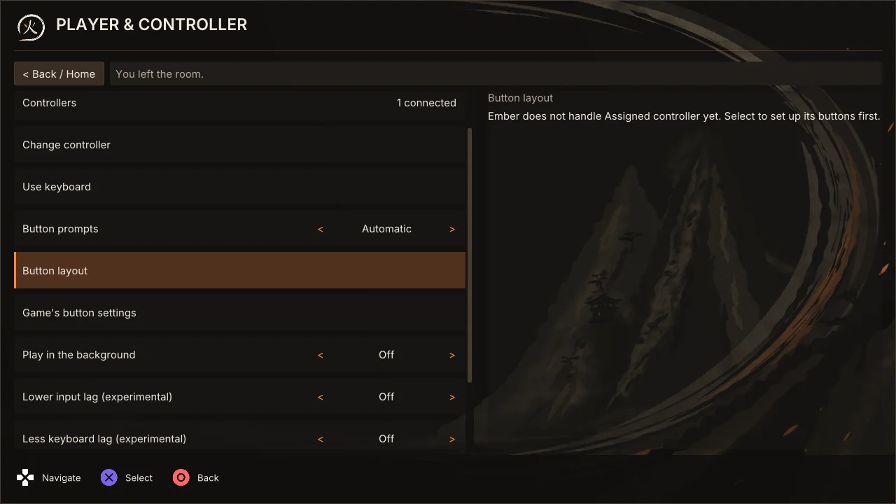
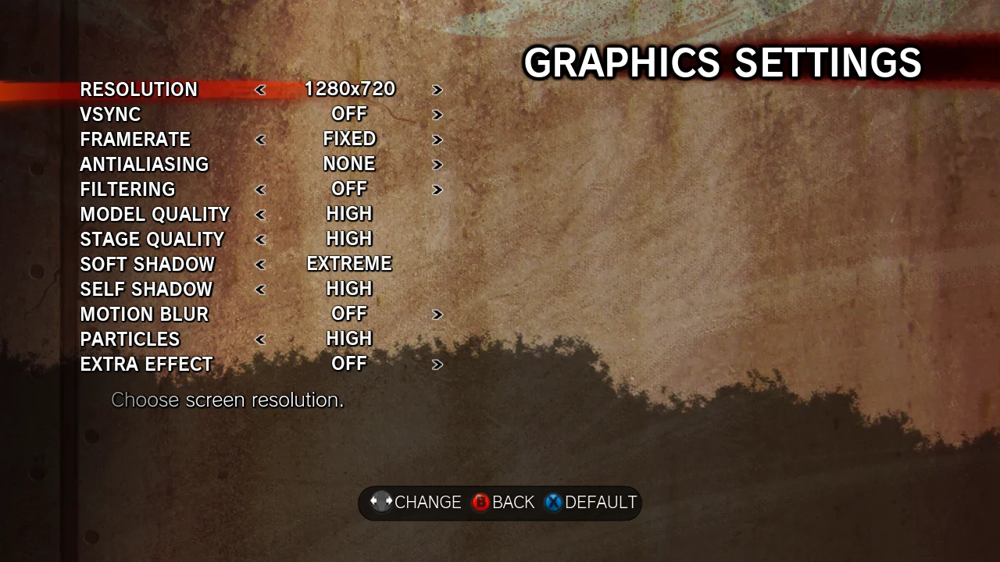

# SF4 Ember Netplay: input lag

The arcade version runs fullscreen at a fixed 60 frames a second. The Steam version adds display options and PC layers that can add delay. This page lists how to set each one as close to the arcade as a PC allows.

## Ember settings

- **VSync is forced off.** The game's own frame limiter keeps it at 60 frames a second, so no queue of finished frames adds delay.
- **Faster display (1 frame less)**, under Settings > PLAYER & CONTROLLER, is on by default and turns off the game's rendering thread, which shows each frame a frame late. Turn it off only if the game drops below 60 fps. Changes apply the next time the game starts.

  

- **Lower input lag** and **Less keyboard lag**, on the same page, are experimental and start off. Their in-game descriptions say what each removes.
- **Input delay** in a room adds the most delay online. Auto picks it from the ping; a lower manual value means more rollback.

## Game and PC settings

- **Frame Rate FIXED and Anti-Aliasing NONE**, as Ember's launch card asks.

  

- **Full Screen OFF.** On Windows 10 and 11 the game's Full Screen is still composed by Windows and queues frames; on a test PC a frame took about 38 ms to reach the screen against 24 ms in a window. A window also lets "Play in the background" work.
- **Refresh Rate:** the highest your screen offers. With VSync off, a 120 or 144 Hz screen shows each frame sooner than a 60 Hz one; the game still runs at 60 frames a second.
- **FreeSync or G-Sync**, if your screen supports it, turned on in both the monitor's menu and the graphics driver. The screen then refreshes as each frame arrives, with no tearing and no VSync delay. Its range must include 60 Hz. It may not work in a window; if it does not, Full Screen with it can be the better choice, which the measuring below can settle.
- **Steam Input off** for the game, unless "Let the game read controllers" is on and you use a PlayStation or Switch pad, which then needs it.
- **Low latency mode** in the graphics driver (NVIDIA Low Latency Mode, AMD Anti-Lag), so the driver keeps at most one frame ready.
- **A wired controller**, and the game or low latency mode of your TV or monitor.

## Measuring

To compare two setups, film the screen and your controller together with a phone's slow-motion mode. Count frames from the button going down to the character moving, repeat it about ten times and compare the averages. Use the same screen, controller and move each time.
