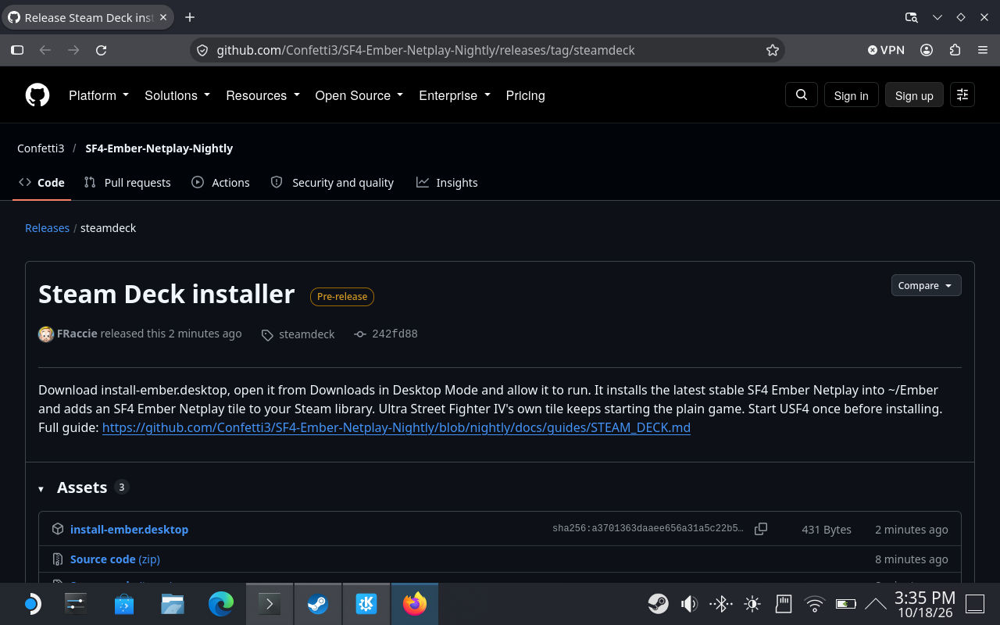
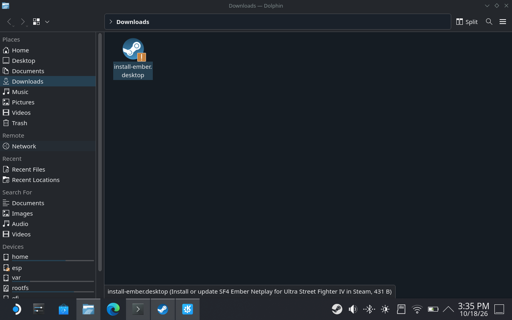
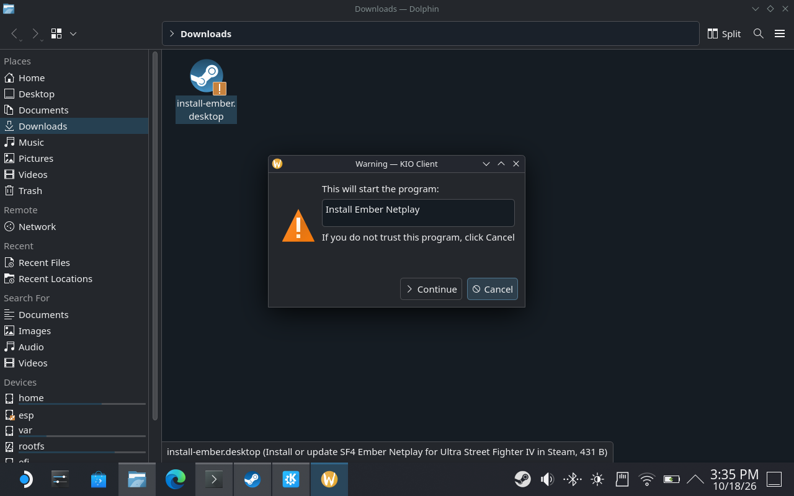
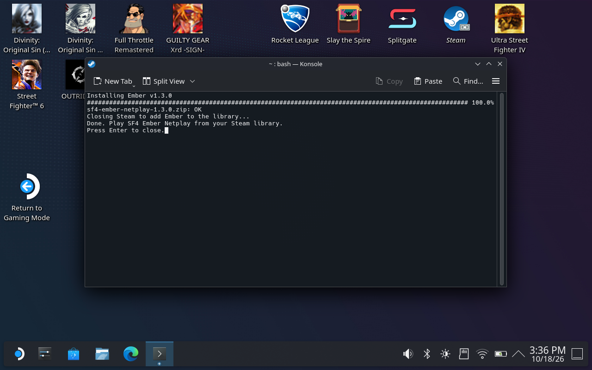
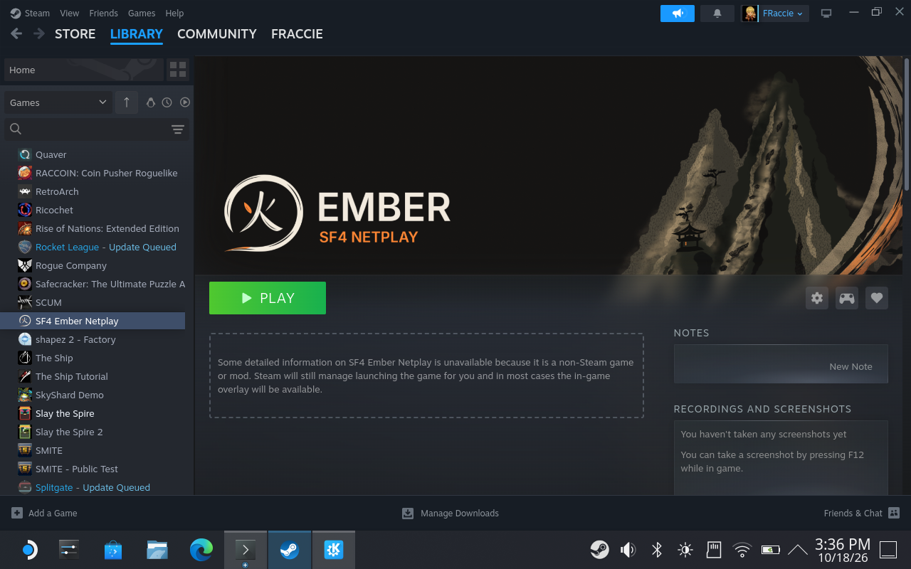
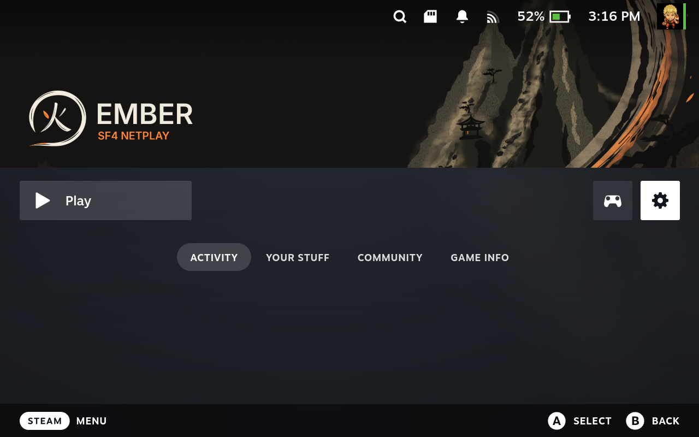

# SF4 Ember Netplay: Steam Deck and Linux

Ember runs on a Steam Deck through the game's own Proton. Installing adds an **SF4 Ember Netplay** tile to the Steam library, under Non-Steam, that starts the game with Ember, in Desktop Mode and in Game Mode. Ultra Street Fighter IV's own tile still starts the plain game. This was tested on a Steam Deck with SteamOS 3.8 and Proton 11.0. Online matches from a Deck, games on an SD card and other Linux systems have not been tested yet.

## Before installing

Start Ultra Street Fighter IV once from Steam, wait for the main menu, then quit. The first start asks you to accept the game's license and downloads about 4 GB of shader cache. If it seems stuck, quit and press **Play** again.

## Install

1. Switch to Desktop Mode (Steam button > Power > Switch to Desktop).
2. In the browser, open the [Steam Deck installer release](https://github.com/Confetti3/SF4-Ember-Netplay-Nightly/releases/tag/steamdeck) and click **install-ember.desktop** under Assets, or download [install-ember.desktop](https://github.com/Confetti3/SF4-Ember-Netplay-Nightly/releases/download/steamdeck/install-ember.desktop) directly.

   

3. Open the Downloads folder and double-click **install-ember.desktop**.

   

4. KDE asks whether to start the program **Install Ember Netplay**. Choose **Continue**.

   

5. A terminal downloads Ember, closes Steam, adds Ember to the library and ends with "Done. Play SF4 Ember Netplay from your Steam library." Steam opens again on top of it; press Enter in the terminal to close it.

   

6. Play **SF4 Ember Netplay** from your Steam library, in Desktop Mode or Game Mode. At the game's title screen, press Start and Ember opens.

   

   

The installer downloads the latest stable release, checks its SHA-256 and extracts it into the game's Proton folder as `C:\Ember`, replacing any earlier copy. On the Deck's internal storage that is `~/.local/share/Steam/steamapps/compatdata/45760/pfx/drive_c/Ember`. Deleting the game's Proton files, for example by uninstalling USF4, also removes Ember. It adds the SF4 Ember Netplay tile with Ember artwork and puts that folder's `steam-launch.sh` in front of USF4's launch option, keeping anything already there. The tile starts USF4 with `-ember`, and only then does that script start Ember. Steam is closed while the installer changes its settings and then started again. Playtime, friends and achievements count for Ultra Street Fighter IV, since that is the game that runs.

## Typing without a keyboard

Hold the Steam button and press X to show the on-screen keyboard, for your player name, invitations, chat and passphrases. With an external controller, hold the Guide button and press X on an Xbox-style pad, or hold the PS button and press Square on a PlayStation pad.

## Ember ID passphrase

Rooms work without an Ember ID. You need one for tournaments and to connect Discord, under **Online play > Ember ID**. Wine and Proton cannot use Windows' own key protection, so on the Deck a passphrase protects your Ember ID instead:

1. Type a passphrase in **Passphrase for this PC**, then the same one in **Repeat passphrase**.
2. Choose **Create Ember ID**.
3. Each time the game starts, Ember asks for the passphrase once. Enter it under **Unlock**.

Keep the passphrase somewhere safe. A backup of your Ember ID can restore it with a new passphrase if you forget it.

## Updating

Run the installer again. Your Ember settings, replays and logs live in the game's Proton folder and are kept. Ember's own updater has not been tested under Proton.

## Uninstalling

Remove the SF4 Ember Netplay tile (its gear > Manage > Remove non-Steam game), remove the quoted `.../Ember/steam-launch.sh` from **Launch Options** in USF4's **Properties**, then delete the `Ember` folder in the game's Proton folder.

## Logs

Ember's settings and logs are in the game's Proton folder; [Saving logs](SAVING_LOGS.md) gives the path.

## Troubleshooting

- **First start stops at the license or the shader download:** quit and press **Play** again.
- **Nothing seems to happen after Play in Desktop Mode:** the game window can open behind Steam's window; click the game in the taskbar. Game Mode always shows it full screen.
- **"Quit USF4 first.":** close the game, then run the installer again.
- **"Steam did not close":** quit Steam yourself, run the installer again, then start Steam.
- **Ember asks for a passphrase every time the game starts:** this is expected under Proton; see [Ember ID passphrase](#ember-id-passphrase).
- **SF4 Ember Netplay starts the game without Ember:** check that USF4's **Launch Options** still has the quoted `.../Ember/steam-launch.sh` before `%command%`, or run the installer again.

For everything else, see [Troubleshooting](TROUBLESHOOTING.md).
