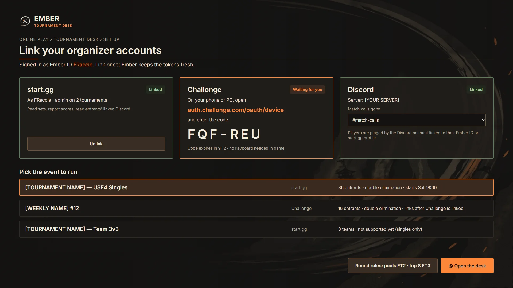
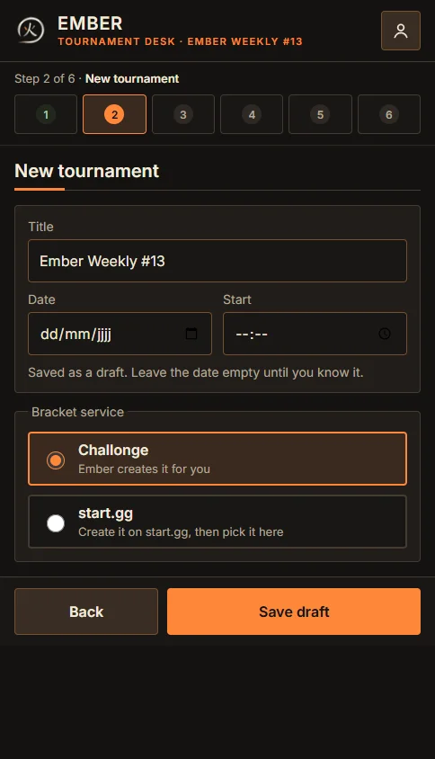
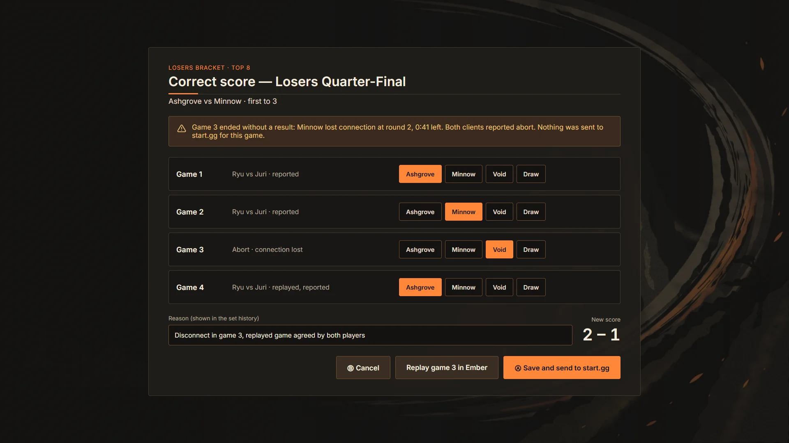
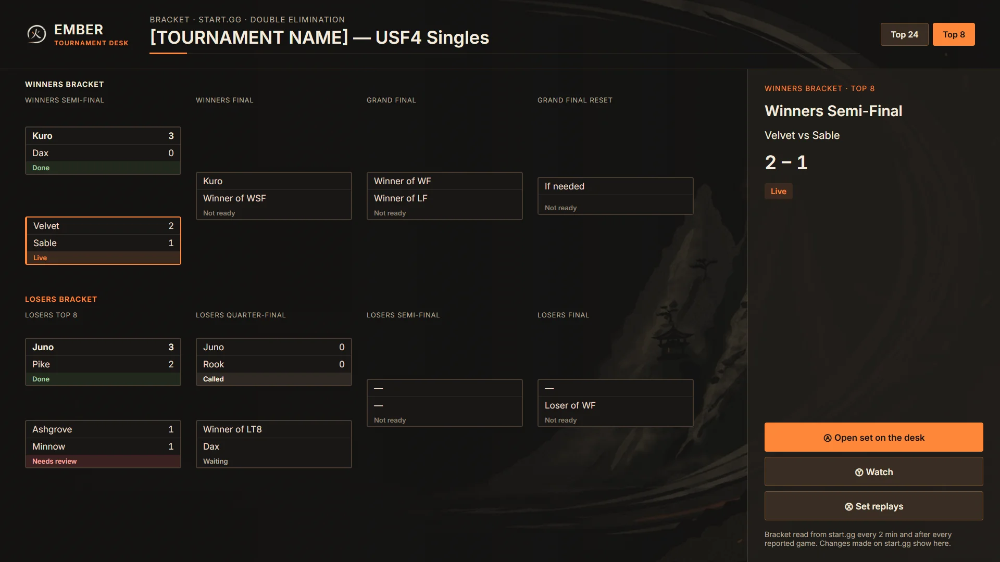
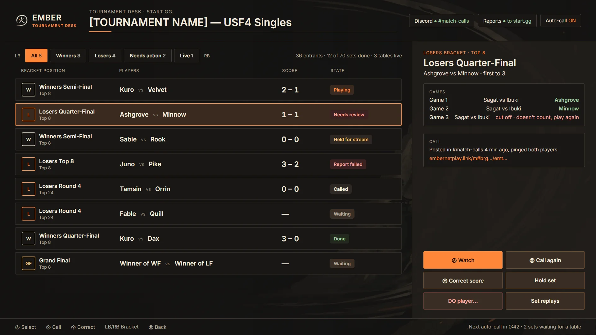

# SF4 Ember Netplay: tournament mode

Tournament mode runs an online USF4 event on **Challonge** or **start.gg** through Ember. The bracket site keeps the bracket; Ember creates every match, calls the players on Discord, plays the sets in Ember rooms and reports each score back to the site. The tournament organizer (TO) runs it from the **tournament desk**, on a phone or a computer.

The desk is part of the Ember bridge. On the nightly bridge it is at `https://ember-bridge.fraccie.be/desk`; every event also gets a public page at `/t/<event>` on the same address.

> Tournament mode is new. Parts marked *not tested live yet* work against the test copies of Challonge and start.gg but have not run against the real sites.

## For TOs

### 1. Link your accounts in Ember

The desk knows you by your Ember ID, which lives in the game. Link the bracket site there once.

1. In Ember, open **Online play > Ember ID > Linked accounts**.
2. Pick **Challonge** or **start.gg** and connect your account. Your browser opens the site; approve Ember there.
3. Back on the same screen, select **Organizer access**. The browser opens again and asks for the organizer permissions: reading your events and reporting scores, and on Challonge also creating tournaments and adding players. Approve, then come back to the screen; the row now says **Allowed**.
4. Optional but useful: connect **Discord** on the same screen, so calls can ping you as a player too.

Organizer access can be taken away from the same row; your account stays connected. Disconnecting the account removes the organizer access with it.

### 2. Sign in on the web desk

1. Open the desk address on your phone or computer.
2. Select **Sign in with Challonge** or **Sign in with start.gg** and approve on the site.
3. You come back signed in for 30 days. **Sign out** ends it.

Only an account already linked in Ember can sign in. If the desk says the account is not linked, do step 1 first.

### 3. Create a tournament

The desk walks you through six steps. On a phone they show as numbered circles at the top; on a wider screen as a list on the left.

1. **Accounts.** Shows each bracket site and whether you have organizer access. **Allow** fixes a missing one.
2. **New tournament.** A title is all a draft needs. Date and start time can stay empty until you know them. A draft creates nothing on any site.
3. **Service and settings.** Pick the bracket service:
   - **Challonge: Ember creates it for you.** Choose the format (single or double elimination, round robin, swiss), the grand final (standard, single match or skip), a third place match, open sign-up, and whether players sign up through Ember. **Create on Challonge** makes the tournament on your account and adds its page as the first link. *Not tested live yet.*
   - **start.gg: create it on start.gg, then pick it here.** start.gg does not let other apps create events, so make the tournament and event on start.gg first, then select it under **Pick an event**.
   - Both: **Games to win** (first to N), with longer sets for later rounds or a phase such as Top 8, and on start.gg **Hold sets assigned to a stream**.
4. **Links.** Add any links with a label: Matcherino, the Twitch stream, the rules, your Discord server. The bracket page is already there. Links must start with `https://`.
5. **Discord post.** See below.
6. **Live.** Where you run the event once it starts.

When date, service and settings are filled in, **Mark ready**. Ember runs the event from its start time: it creates each set's match as soon as both players are known. **Delete this draft** removes a draft; **Stop this tournament** stops a ready or running one.

### 4. The Discord announcement

The **Discord post** step builds one message with everything in it: title, date, format, the bracket, sign-up, stream and Matcherino links, and where to get Ember. **Copy message** puts it on your clipboard; paste it in your announcements channel. The date uses Discord's own time codes, so every reader sees it in their own time zone. Lines with nothing filled in are left out.

When the event is public, its public page is linked too, and Discord shows a preview card with the title and start time.

### 5. Discord calls

Ember can post each set's call in a channel of your server. It uses a channel webhook, so there is no bot to install.

Make the webhook in Discord:

1. Open **Server Settings > Integrations > Webhooks**.
2. Select **New Webhook**, give it a name such as *Ember calls*, and pick the channel the calls go to.
3. Select **Copy Webhook URL**.

Then on the desk, in the event's settings, paste it into **Discord webhook** and save.

- A call is posted when Ember creates a set's match, and again each time you use **Call again**. It names the round and phase, first to N, both players and the match link.
- Players whose Discord is linked to their Ember ID are pinged. Nobody else can be pinged by a call.
- With **Post each set's score** on, the result is posted when each called set ends.
- The webhook is stored encrypted and shown back only masked. **Remove the webhook** stops the calls.

*Not tested live yet* against a real Discord server.

### 6. Sign-ups through Ember

For a tournament Ember created on Challonge, turn on **Players sign up through Ember**. Players then sign up on the event's public page (or from Ember), and Ember adds each one to the Challonge bracket under their Challonge username. The desk shows how many have signed up. Sign-ups close when the event is marked ready. *Not tested live yet.*

### 7. Running the event

Open the event and go to **Live**. The sets refresh every 10 seconds.

- The tiles at the top count the sets that **need you**, the ones **live**, and the ones **done**.
- Filters: **All**, **Winners**, **Losers**, **Needs action**, **Live**.
- Each set card shows the round, side and phase, the players, the score and its state:

| State | Meaning |
|---|---|
| Not ready | Waiting for an earlier set. |
| Waiting | Both players known, match not created yet. |
| Called | The match is created and the players are called. |
| Playing | The set is being played in Ember. |
| Needs review | A game ended without a result both players agree on, such as a disconnect. You decide it. |
| Reporting | Ember is sending the score to the bracket site. |
| Done | The site has the result. |
| Held | You held the set; Ember does not create its match. |
| Needs organizer | Something Ember cannot settle itself; fix it on the bracket site. |

Actions on a set:

- **Hold** keeps a set out of Ember, for example to play it on stream. **Release** lets Ember run it again.
- **Call again** posts the call to Discord again. The card shows when it was last called and whether Discord received it.
- **Games** lists the set's games. For a game that **needs review**, give it to the right player (**Give … the game**) or **Void** it so it is played again. You can also **Add a game** won by a player, and void a game that was accepted. Every decision asks first and keeps your reason.

**After a disconnect:** if a player's connection drops and the game never ends, the game is reported as cut off and the set shows **Needs review**. Decide the game, or void it so the players play it again from the same link. The score only goes to the bracket site after that.

### 8. Public page and phone viewer

Turn on **Public page anyone can follow** in the event's settings. The page at `/t/<event>` shows the title, the date in each viewer's own time, the links, the live sets and the bracket, refreshing every 15 seconds. It shows players by name only. While sign-ups are open it has a **Sign up** button. Turn public off and the page is gone.

### 9. Bracket view

The Live step and the public page both have the bracket: tabs per phase, then the winners and losers rounds and the grand final. Each round is a section you can fold; on a phone they stack, on a wider screen they sit side by side. The whole bracket is read from the site every 10 minutes and the open sets on every read in between, so a set decided on the site shows up within 10 minutes.

### 10. The desk in the game

*In progress.* Online play > Ember ID will get a **Tournament desk** while you hold organizer access, with the same sets queue (LB/RB for the filters), the bracket view, and the actions above on a controller. Until then, the Linked accounts screen shows the web desk's address.

### 11. Ending an event

The event ends with the bracket on the site. **Stop this tournament** stops Ember from creating more sets; sets already decided stay as they are on the site.

### Troubleshooting

- **"Not linked: connect it in Ember first"** when signing in on the web: link that site's account in Ember (step 1), then sign in again.
- **A player is never called.** Ember finds players by the bracket site account they linked in Ember. A player who has not linked their Challonge or start.gg account in Ember is skipped until they do; ask them to follow *For players* below.
- **No calls in Discord.** Check the webhook is still there in Discord (deleting it there breaks it). A set's card says **Discord refused it** when Discord rejects the post; paste a new webhook.
- **Challonge requests.** Challonge allows a limited number of requests a month per app. Ember spreads its reads within that budget; if it runs out, sets are read less often and sign-in may say it is busy. Running several big events in one month on Challonge can reach it.
- **Organizer access asks again.** Organizer sign-ins made before Challonge's write permissions were added must be done again to create tournaments or add players.

## For players

1. **Link your account.** In Ember, open **Online play > Ember ID > Linked accounts** and connect the site the tournament uses (Challonge or start.gg), and Discord if you want to be pinged. This is how the TO's bracket finds you.
2. **Sign up.** If the tournament takes sign-ups through Ember, open its public page and select **Sign up**, signing in with the account you linked. Otherwise sign up on the bracket site as usual, with the same account.
3. **Get called.** When your set is ready, the call appears in the TO's Discord channel with a match link, and in Ember under your tournament matches.
4. **Play.** Open the link, or select the match in Ember. Ember opens the match's room; play first to N. Each game's result is reported by itself; you report nothing.
5. **If you disconnect.** The game that was cut off is not counted for either player. The TO decides it or has it played again; reopen the same link to continue the set.
6. **Replays.** Every game of your set is kept, grouped by set, under **Replays > Tournaments**, with the tournament and round on each set.

## Limits today

- A score that was already sent to the bracket site is corrected on the site, not from the desk.
- start.gg events are created on start.gg; Ember only picks them up.
- Signing up through Ember needs a Challonge account linked in Ember.
- A player plays one match at a time; a set waits while one of its players is still in another.
- Players whose Discord is known only through start.gg are not pinged by calls.
