# Running a tournament with Ember, step by step

Ember runs an online USF4 event on **Challonge** or **start.gg**. The bracket
site keeps the bracket; Ember creates every match, calls the players on
Discord, plays the sets in Ember rooms and reports each score back to the
site. You run it from the **tournament desk**, a web page that works on a
phone, a tablet or a computer.

On the nightly service the desk is at `https://desk.ember.fraccie.be`
(`https://ember-bridge.fraccie.be/desk`). Every event also gets a public page
at `https://tournament.ember.fraccie.be/<event>` (`/t/<event>` on the
bridge's address).

The pictures on this page come from the automated test of a whole tournament
(docs/guides/TOURNAMENT_TEST.md), so they show what you will see.

**What you need**

- Ember, with an Ember ID (**Online play › Ember ID**).
- A Challonge or start.gg account for running the bracket.
- Optional: a Discord server where you can make a webhook, for calls.

---

## Step 1. Link your bracket site in Ember (once)

The desk knows you by your Ember ID, which lives in the game.

1. In Ember, open **Online play › Ember ID › Linked accounts**, pick
   **Challonge** (or **start.gg**) and connect your account. Your browser
   opens the site: sign in and approve Ember.
2. Open **Online play › Ember ID › Tournament organizer**. Each site has an
   **organizer access** row. **Allow** opens the browser again, this time for
   the organizer permissions (reading your events and reporting scores; on
   Challonge also creating tournaments and adding players). Approve. The row
   shows **Allowed** within a few seconds.
3. Optional: connect **Discord** under Linked accounts, so calls ping you when
   you play too.

Removing organizer access keeps your account connected; disconnecting the
account removes organizer access with it.

## Step 2. Open the desk

In Ember, **Online play › Ember ID › Tournament organizer** offers two ways.

**On this PC: Open the desk in your browser.** The desk opens already signed
in. No code is shown, so this is the one to use while you stream.

**On another device: Sign in on another device.** Do this off stream.

1. On the phone, tablet or laptop, open the desk address and press
   **Show code**. It shows a six-digit code for two minutes.

   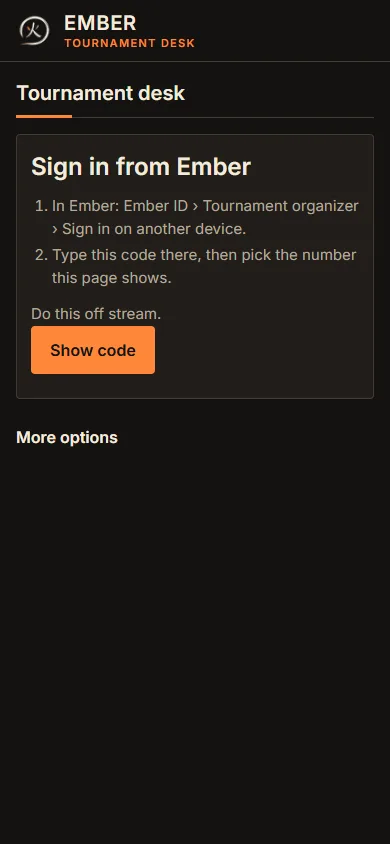
   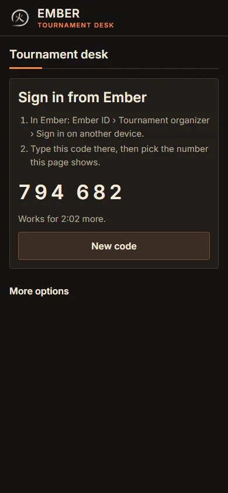

2. In Ember, choose **Sign in on another device** and type the code.

3. Ember shows which browser and system asked, and when, with three numbers.
   The page on your device now shows one number. If the device is yours, pick
   that same number in Ember.

   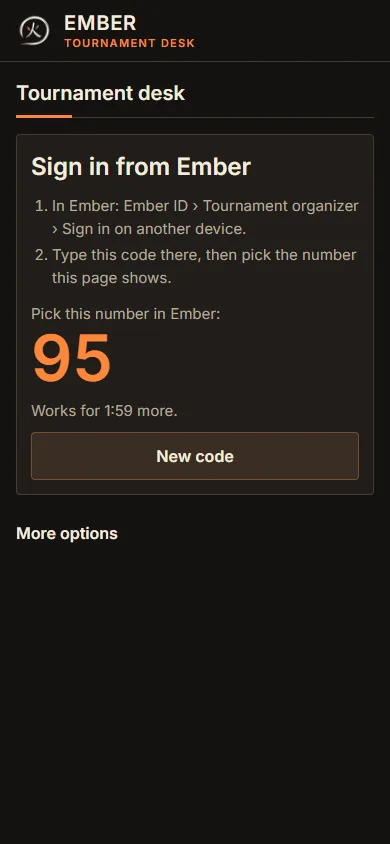

4. The device is signed in.

Only the browser that showed the code can sign in with it, and a wrong
number ends the code. A code someone sends you, or reads off your stream, is
no use to them.

The web session ends after 12 hours, or after 2 hours you don't use it.
**Sign out** ends it sooner. In Ember, **Tournament organizer** shows
**Signed in on the web** with **Sign out everywhere**, and tells you once
about each new sign-in.

You can also sign in on the desk with Challonge or start.gg alone. That desk
can run sets and edit drafts, but cannot create or ready a tournament or
change its webhook, public page or sign-ups: for those it asks you to open the
desk from Ember.

## Step 3. Create the tournament

**Your tournaments** lists each bracket site with your organizer access, then
your tournaments. Select **New tournament**: four steps, each with one
**Save**. A problem shows at the top of the step.

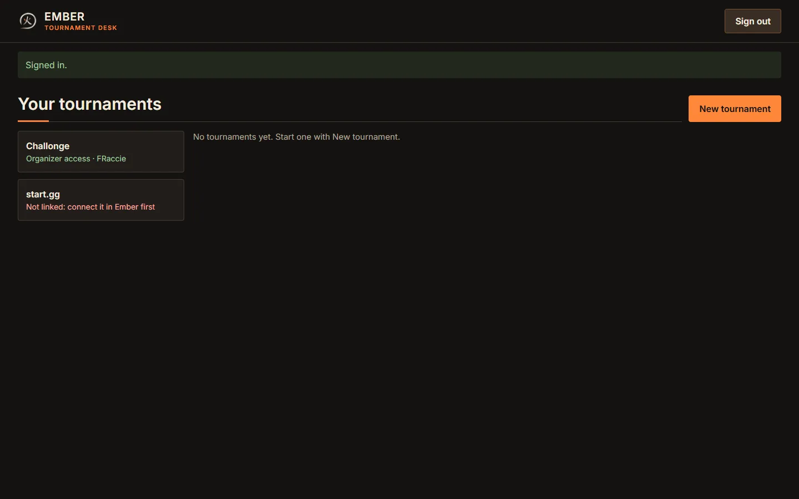

**1. Details.** A title is all a draft needs. Add the date and start time when
you know them, and your links: the stream, Matcherino, the rules, your
Discord. Links start with `https://`. A draft creates nothing on any site.

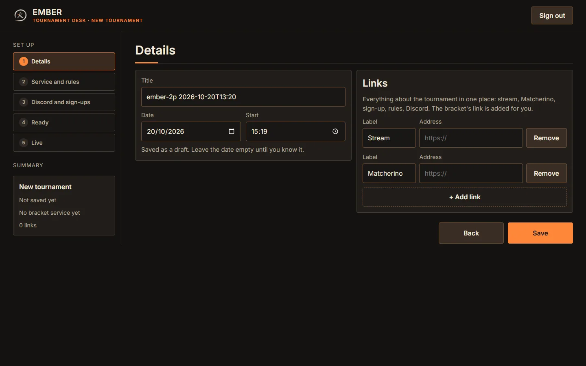

**2. Service and rules.** Pick the bracket service.

- **Challonge: Ember creates it for you.** Choose the format (single or double
  elimination, round robin, swiss), the grand final, a third place match and
  Challonge's own sign-up page. **Create on Challonge** makes the tournament
  on your account and adds its page as the first link.
- **start.gg: create it on start.gg, then pick it here.** start.gg doesn't let
  other apps create events.
- **Games to win**: **Everything first to** a number, then tiers for later
  stages, each **From** a stage (Top 32 down to Top 4, quarter-finals,
  semi-finals, finals, grand final) **first to** a number. **+ Add a tier**
  adds one. The latest stage that applies to a set wins.

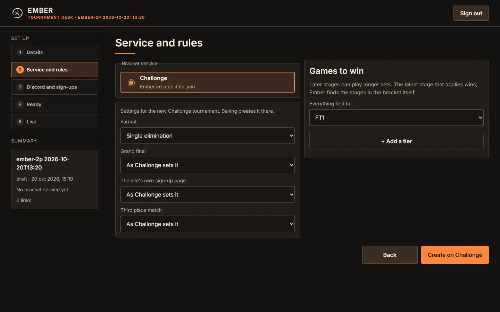

**3. Discord and sign-ups.** Paste your Discord webhook for calls (Step 5),
choose whether each set's score is posted, turn on the public page, and let
players sign up through Ember.

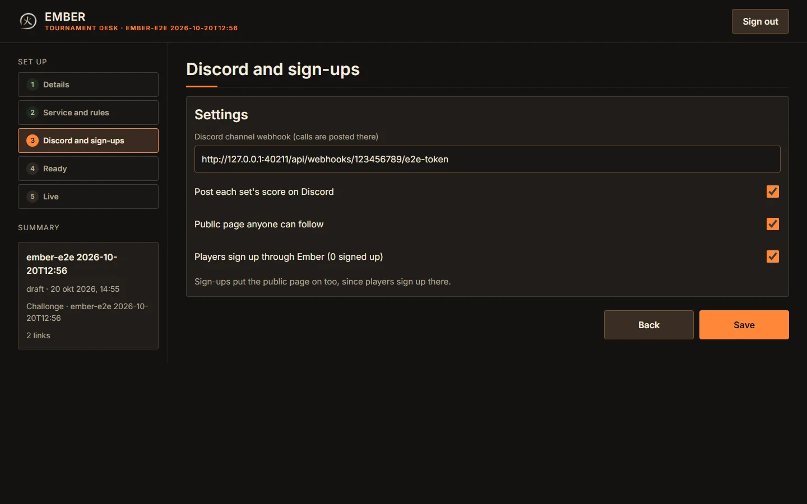

**4. Ready.** The announcement for your Discord, with **Copy message**. Its
date uses Discord's time codes, so every reader sees their own time zone.
**Mark ready** waits until the tournament has a start date and its bracket.

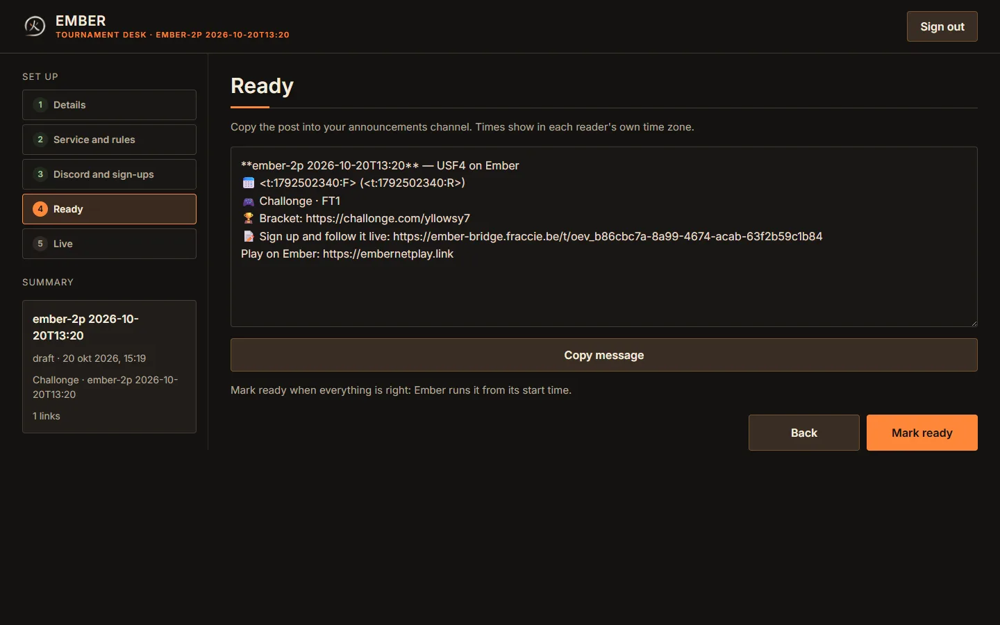

## Step 4. Take sign-ups and start the bracket

While the tournament is a draft, players sign up on its public page or in
Ember with the account they linked. Ember adds each one to the Challonge
bracket under their Challonge username. The desk counts them.

Sign-ups close when you **Mark ready**. From the start time, open **Live**:
**Start the bracket on Challonge** starts it (seeding is fixed from then on).
Ember reads the bracket within a few minutes and calls the first sets.

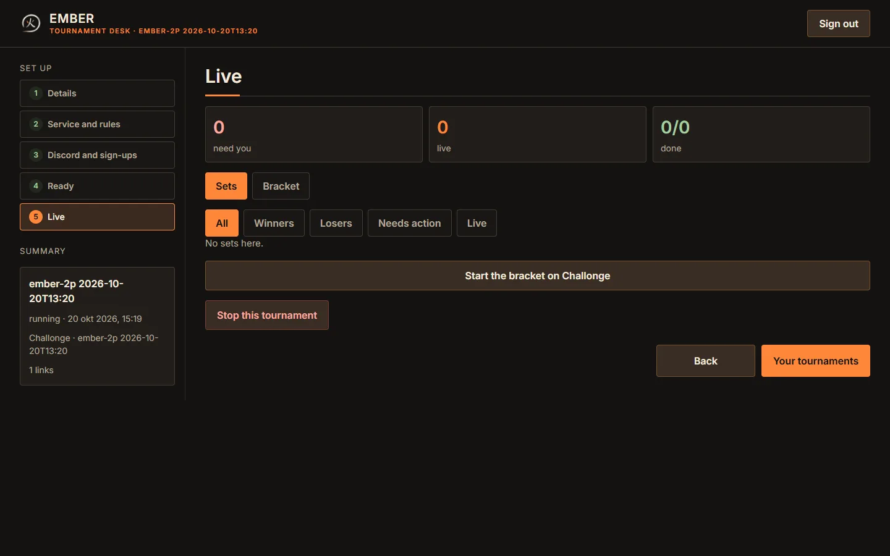

## Step 5. Discord calls

Make the webhook in Discord: **Server Settings › Integrations › Webhooks ›
New Webhook**, name it (for example *Ember calls*), pick the channel and
**Copy Webhook URL**. Paste it in Step 3 of the desk.

- Each set's match is called when Ember creates it, and again with **Call
  again**: round, first to N, both players and the match link.
- Players whose Discord is linked to their Ember ID are pinged, and each
  also gets the match link in a private message from the Ember bot. On
  start.gg, a player who linked Discord on their start.gg profile but not in
  Ember is reached through that one. Discord
  only lets the bot message someone who shares a server with it, such as the
  Ember Discord. The set card says who got it: *sent*, *no Discord linked*,
  or *Discord refused it*.
- With **Post each set's score** on, the result is posted when the set ends.
- The webhook is stored encrypted and shown only masked.

## Step 6. Run it live

**Live** refreshes every 10 seconds. The tiles count the sets that **need
you**, are **live**, and are **done**. Filter by **Winners**, **Losers**,
**Needs action** or **Live**.

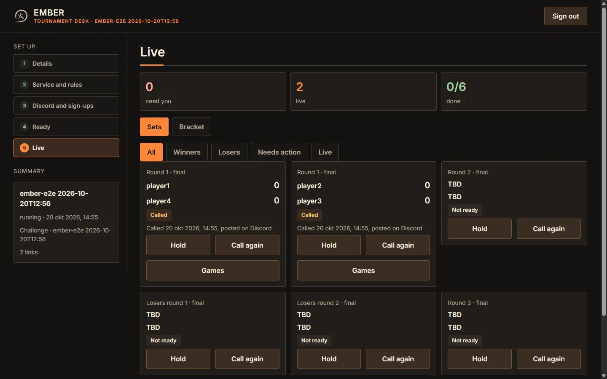

While a set is played, both players are in an Ember room. Here the first
game of the test's set has run out of time with nobody hit: a draw, so it is
played again.

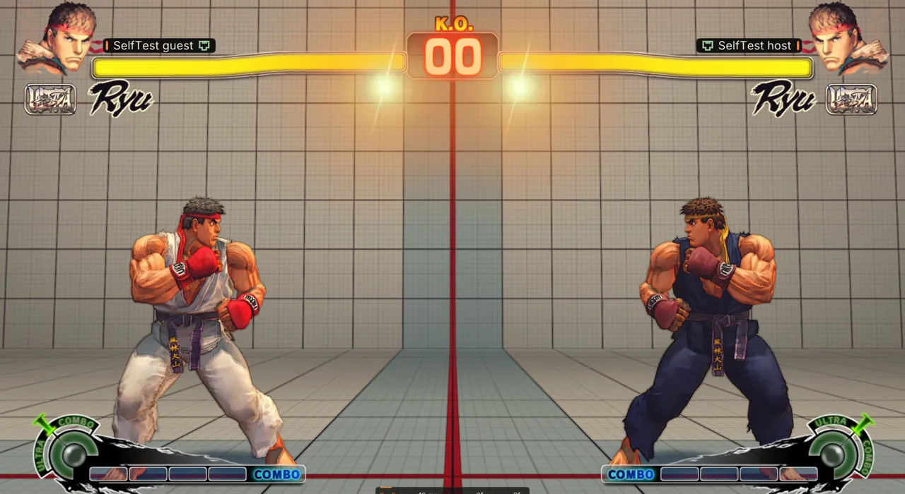

Each card shows the round, the players, the score and its state:

| State | Meaning |
|---|---|
| Not ready | Waiting for an earlier set. |
| Waiting | Both players known, match not created yet. |
| Called | The match is created and the players are called. |
| Playing | The set is being played in Ember. |
| Needs review | A game ended without a result both players agree on, such as a disconnect. You decide it. |
| Reporting | Ember is sending the score to the bracket site. |
| Done | The site has the result. |
| Held | You held the set; Ember doesn't create its match. |
| Needs organizer | Something Ember can't settle itself; fix it on the bracket site. |

On a set:

- **Hold** keeps it out of Ember, for example to play it on stream.
  **Release** gives it back.
- **Call again** posts the call again. The card says when it was called and
  whether Discord took it.
- **Games** lists its games. A game that **needs review** can go to either
  player, be a **Draw** (played again), or be **Voided** (played again too).
  You can also add a game, or void one that counted. Each asks first and keeps
  your reason.

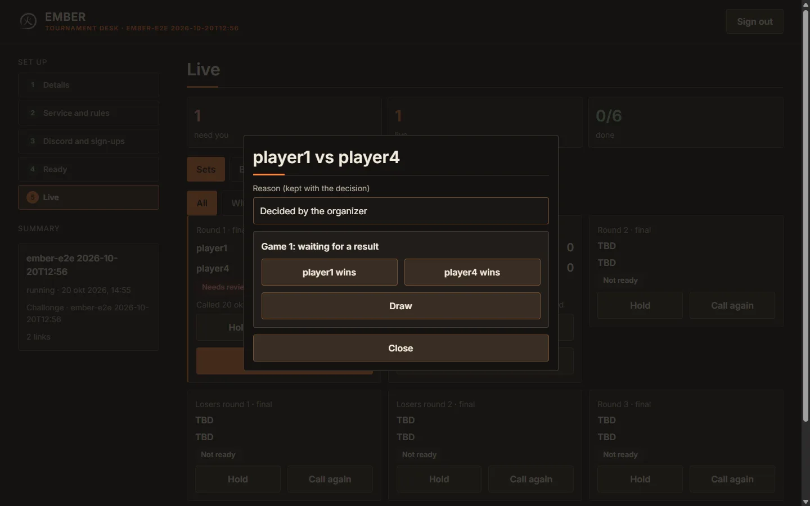

**Draws.** A drawn game (double KO, or a time out with equal life) scores for
nobody and is played again, so a set always ends with a winner. The desk, the
public page and the Discord score show the draws: "1 – 0, 1 draw".

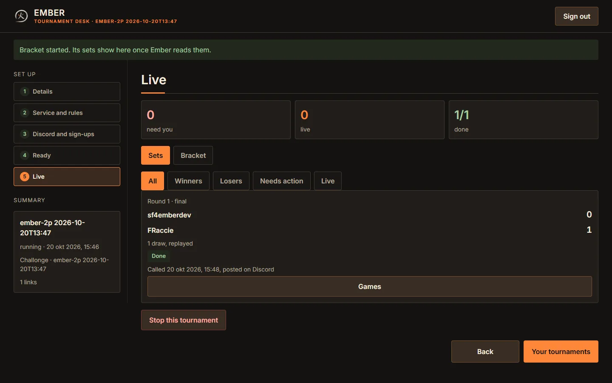

**Bracket view.** **Bracket** shows the phases, then the winners and losers
rounds and the grand final, side by side on a wide screen.

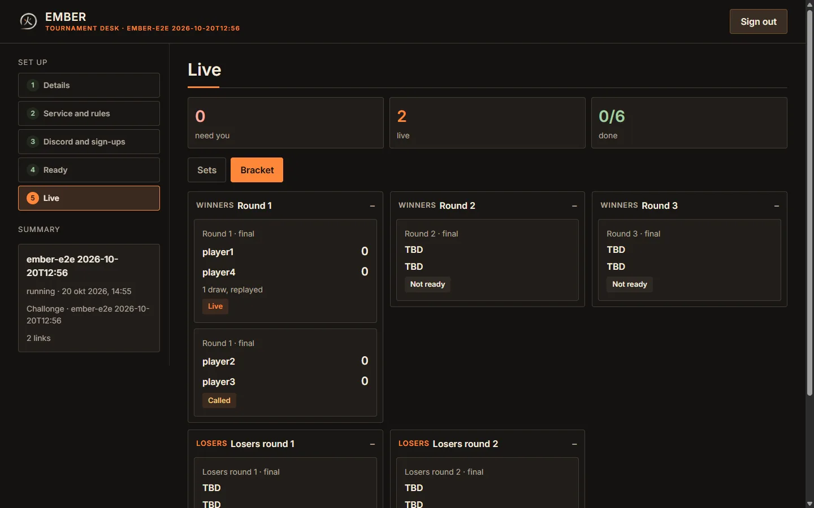

**The desk in the game.** **Tournament organizer** in Ember has the same:
your events, their sets as a list or a bracket, and every action on a set.

## Step 7. The public page

With **Public page anyone can follow** on, `/t/<event>` shows the title, the
date in each viewer's time, the links, the live sets and the bracket. Players
show by name only. While sign-ups are open it has **Sign up**.

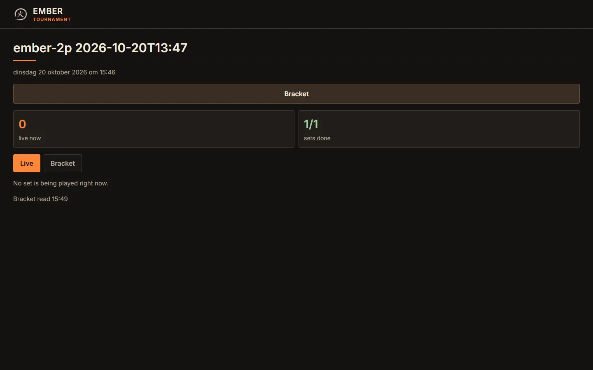

## Step 8. Finish

**Stop this tournament** stops Ember creating sets; the bracket stays on the
site. For a tournament Ember created on Challonge you choose each time
whether it goes on Challonge too: **Stop it and delete it on Challonge**
removes its bracket and results for everyone. A tournament you picked from
your own Challonge list is never deleted there. A draft is deleted the same
way.

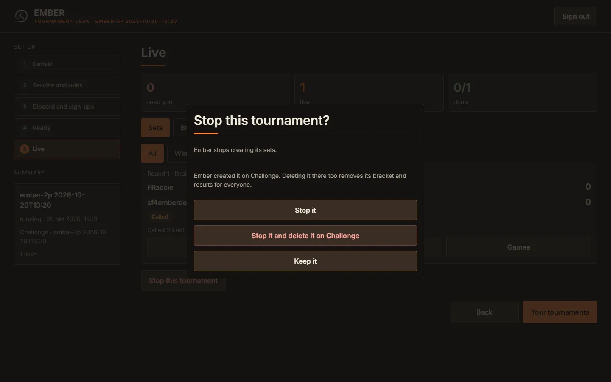

---

## For players

1. **Link your account.** In Ember, **Online play › Ember ID › Linked
   accounts**: connect the site the tournament uses (Challonge or start.gg),
   and Discord to be pinged and get your match link privately (be in the
   Ember Discord for that). This is how the bracket finds you.
2. **Sign up** on the tournament's public page, or in Ember, with that
   account. Without sign-ups through Ember, sign up on the bracket site with
   the same account.
3. **Get called.** The call appears in the organizer's Discord with a match
   link, and in Ember under your tournament matches.
4. **Play.** Open the link or pick the match in Ember. Ember opens the
   match's room; press Ready, and after each game Rematch. Results report
   themselves.
5. **If you disconnect,** the cut-off game counts for nobody. The organizer
   decides it or has it played again; reopen the same link to go on.
6. **Replays** of your set are under **Replays › Tournaments**, where
   **Export set videos** makes a video of each game, the set's score in its
   caption.

---

## FAQ

**Do I have to use Discord?** No. Without a webhook nobody is called on
Discord; players still find their matches in Ember.

**Can I stream while I sign in?** Use **Open the desk in your browser** on the
streaming PC: it shows no code. Sign in on another device off stream.

**Can players sign up on Challonge instead?** Yes, with the same account they
linked in Ember. Ember finds them by that account.

**Can I change the score after it reached Challonge?** Not from the desk;
correct it on Challonge.

**What happens with a drawn game?** It counts for nobody and is played again.
In round robin and swiss, a drawn *set* exists only if you enter it on
Challonge; you choose what it is worth when Ember creates the tournament.

**Why is start.gg different?** start.gg doesn't let other apps create events:
make the event there and pick it in Step 3.

**Does deleting on the desk delete on Challonge?** Only when you choose
**… and delete it on Challonge**, and only for tournaments Ember created.

## Troubleshooting

| You see | What to do |
|---|---|
| **That code is wrong or expired** in Ember | Codes last two minutes and work once. Press **New code** on the device. |
| **That is not the number the other device shows** | The code is ended. If the device and time Ember showed weren't yours, someone tried to get you to sign in their browser. Otherwise make a new code. |
| **Not linked: connect it in Ember first** on the web | Do Step 1, then sign in again. |
| **Open the desk from Ember** | That change needs the desk opened from Ember (Step 2), not a site sign-in. |
| **Challonge refused the settings: …** | Challonge's own reason follows. Change that setting and **Create on Challonge** again. |
| **Sign-ups for this event are closed** | Sign-ups close at **Mark ready**. Add late players on Challonge with their linked account. |
| **Connect your account on the event's site in Ember first** (a player signing up) | The player links Challonge in Ember (For players, step 1). |
| **The sign-in service is busy** | Ember spreads its Challonge requests over the day and the month to stay within Challonge's limit. Try again later; running many events in a month can reach it. |
| The sets don't appear after **Start the bracket** | Ember reads the bracket every few minutes. Wait, then check the tournament started on Challonge. |
| A player is never called | Ember finds players by the account they linked in Ember. Ask them to do For players, step 1. |
| A player didn't get the private message | The set card says why. *No Discord linked*: the player links Discord in Ember. *Discord refused it*: the player joins a server the Ember bot is in, such as the Ember Discord, and allows messages from server members. **Call again** sends it again. |
| No calls in Discord | Check the webhook still exists in Discord. A card says **Discord refused it** when Discord rejects a post; paste a new webhook. |
| **Challonge refused to delete the event** | Ember resets a started bracket before deleting it. If Challonge still refuses, delete it on Challonge. |
| **Organizer access** asks again | Sign-ins made before Challonge's write permissions were added must be done again. |

## Limits today

- A score already sent to the bracket site is corrected on the site.
- start.gg events are created on start.gg; Ember picks them up.
- Signing up through Ember needs a Challonge account linked in Ember.
- A player plays one match at a time; a set waits while one of its players is
  still in another.
