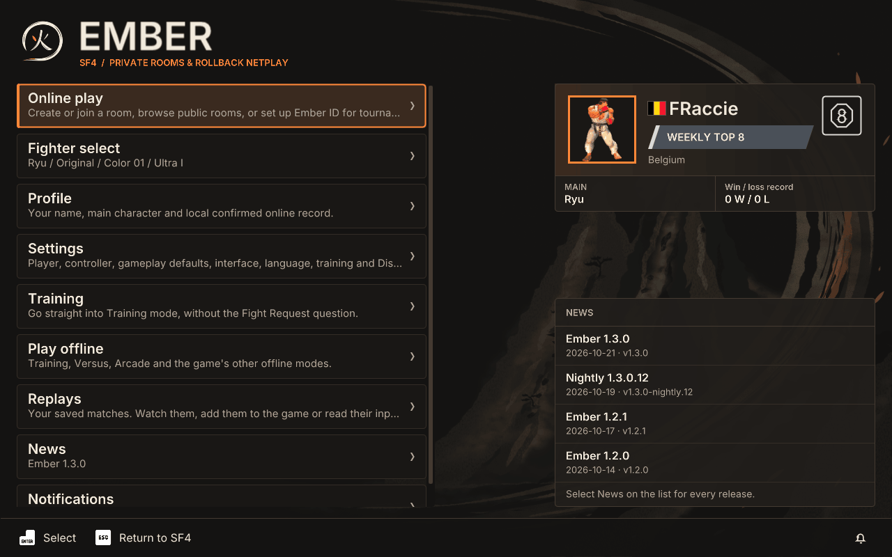
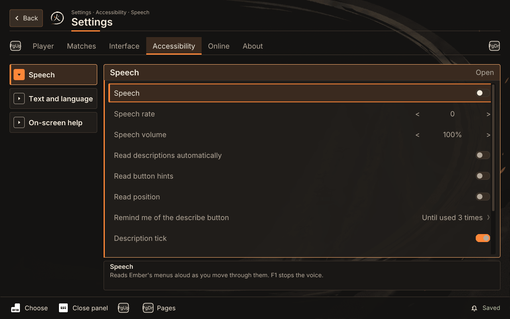
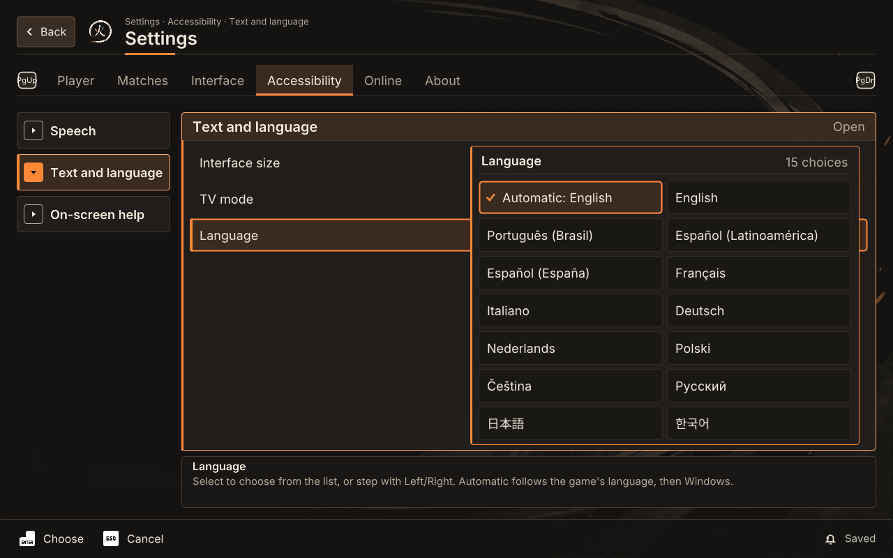
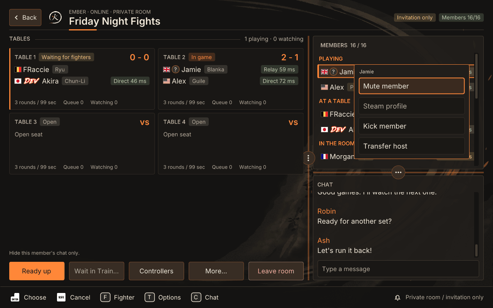
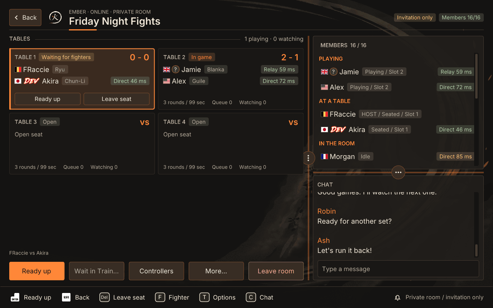
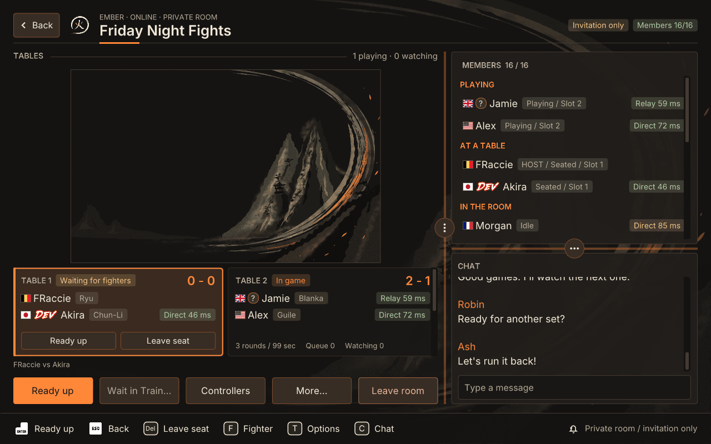
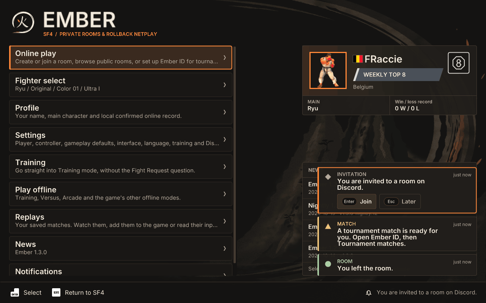
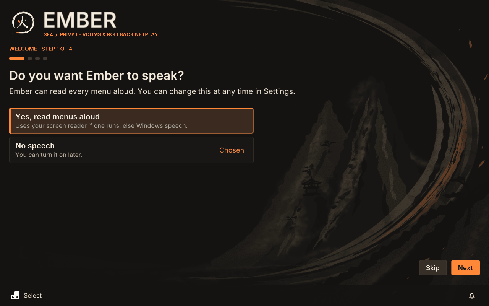
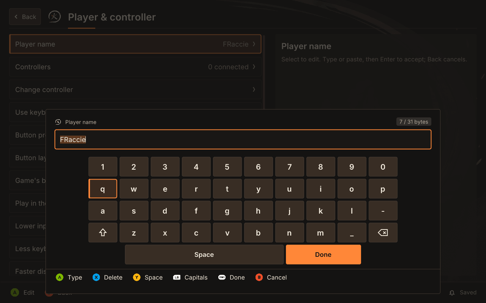
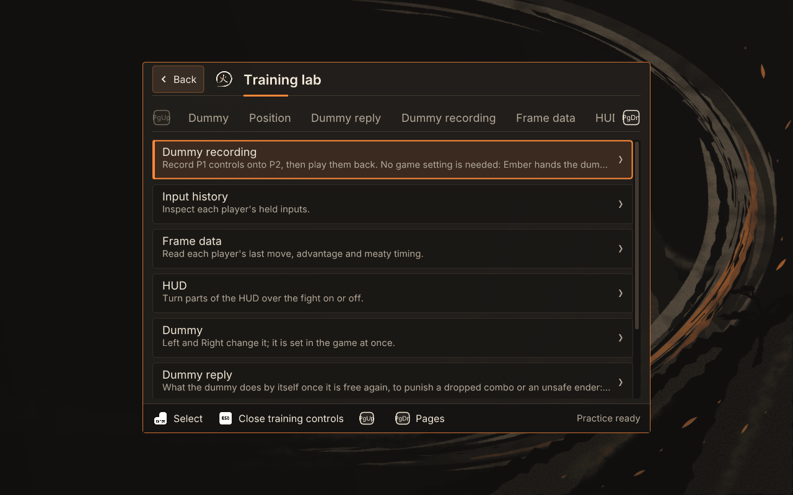

# Ember's V2 menus

V2 is Ember's new look. It is a preview and still being built. It changes
only how the screens look: every row, setting and shortcut of the Classic look
is still there, and works the same with a controller, a stick, the keyboard
and the mouse. Speech reads V2 as it reads Classic.

This guide shows each part of V2 and says how to use it. The buttons are
named as on an Xbox pad; on a stick, Light kick selects and Medium kick goes
back (see [Controller menus](CONTROLLER_MENUS.md)).

## Choose the look

Open Ember (F10, or Start at the game's main menu). Go to Settings, then
Interface, then Look, and choose Classic or V2 (preview). A fresh install
asks this on its first run. You can switch back at any time; your settings,
rooms and records stay as they are.

## Home

Home lists Online play, Fighter select, Profile, Settings, Training, Play
offline, Replays, News and Notifications. On the right are your player card
and the newest News.

- **Training** goes straight into the game's Training mode, without the Fight
  Request question. It is there only outside a room and a match, at the
  game's main menu.
- **Your player card** shows your main, country, title, icon and local
  win/loss record, as others see it. Select it to open Awards: the titles
  and icons you have earned, and how to earn the rest. Titles and Icons are
  two tabs. Select an earned one to wear it on your card. Profile has an
  Awards row too.
- **News** lists Ember's releases on your update channel. Home shows the
  first three; the News row opens all of them, each with its notes.
- **Notifications** lists what Ember told you lately (see Toasts below).

Back at Home hides Ember and returns to the game.

## The header, Back and tabs

Each screen has a header: a Back button on the left, the screen's name, and
above it a line that says where you are, such as Settings · Accessibility ·
Speech. A room's header also shows its state on the right, such as
Invitation only and the member count.

- **Back**: B on a pad, Escape on the keyboard, a click on the header's Back
  button, or the **right mouse button** anywhere. Back first closes an open
  panel, popout or question; only then does it leave the screen.
- **Tabs**: LB and RB step to the previous and next tab; on the keyboard,
  Page Up and Page Down. With the mouse, click a tab, or the LB and RB (PgUp
  and PgDn) marks at the ends of the tab strip. The hint bar names these
  buttons too.

The hint bar at the bottom says what your buttons do on the focused row. Each
hint is also a button you can click. The bell on its right opens
Notifications.

## Settings and its panels

Settings has six tabs: Player, Matches, Interface, Accessibility, Online and
About. Each tab is a column of panels on the left, such as Speech, Text and
language and On-screen help. The panel you are on shows its rows on the
right, and the focused row's description sits under them.

- Move to a panel and press A (Enter, or click) to open it. Its rows take
  the focus.
- B, Escape or a right click closes the panel. The hint bar calls this
  Close panel.
- On a narrow screen, the panels and an open panel each take the whole
  width in turn.

Changes save by themselves. The hint bar shows Saved on the right.

## Values

Rows that hold a value come in three kinds.

- **Switches** (On or Off): A or Enter flips it. Left and Right do too. With
  the mouse, click it.
- **Numbers**, such as Speech rate or Interface size: Left and Right step
  them, and the hint bar says Adjust. With the mouse, click the arrow at
  either end.
- **Choices**, such as Language, show arrows like numbers: Left and Right
  step through the choices, and the hint bar says Adjust. A or Enter opens
  a panel on the row with every choice, the current one ticked, and how
  many there are. Move with the D-pad or arrows and press A to pick; B or
  Escape keeps the old value. With the mouse, click an arrow to step, or
  the choice itself to open the panel; click a choice in it, or right-click
  to close it.

## Popouts

Some rows hold a short list of actions. They open as a small popout: beside
the row with a pad or the keyboard, or where you clicked with the mouse.

- In a room, select a member to open their actions: Mute member, Steam
  profile, and for the host Kick member and Transfer host. Kick and Transfer
  host still ask first.
- **More…** in the room's action bar holds Table options, Room settings and
  the invitation links.

Move with the D-pad or arrows, press A to act, and B, Escape or a right click
to close the popout.

## The room board

The room is one board. The tables are on the left, each a card with its
state, players, score and ping. Members and chat share the column on the
right. The room's actions run along the bottom: Ready up, Wait in Training,
Controllers, More… and Leave room.

- A table card's own buttons (Ready up, Leave seat) are on the card. Select
  the card with A for the seat chooser, as in Classic.
- Members are grouped: Playing, At a table, Watching and In the room. Each
  shows their flag, name, state and ping, such as Direct 46 ms or Relay
  59 ms.
- Chat's Type a message box is at the bottom of the chat. The shortcuts work
  as in Classic: X or F for your fighter, Y or T for Table options, View or C
  for Chat, Delete to leave your seat (see [Controller
  menus](CONTROLLER_MENUS.md#play-online)).

### Layout grips

The line between the tables and the right column has a grip (⋮). Drag it to
make the column wider or narrower. The line between members and chat has a
grip (…) too; drag it to share the column. Both snap to steps, and chat
always keeps three lines.

With a pad or the keyboard, set the same in Settings, Interface, Room
layout: Column width, Members and chat, Ready-made layout (Board first,
Balanced, Chat first) and Restore defaults. The panel shows a preview.

### The cinema picture

When you watch a game with its picture on, the board shows the picture
large, over one row of table cards, instead of in a corner. Widen the tables
with the column grip to make it bigger. On a narrow screen it stays in the
corner window. There, drag the picture to another corner, or drag its grip to
resize it; Settings, Matches has Picture corner and Picture size for the pad
and keys.

## Toasts and Notifications

Ember's notices, such as a room left or an invitation, show as toasts at the
bottom right. Each has a kind (Invitation, Room, Update, Match, System), its
age, and a shape that tells its tone: a disc when something is done, a
triangle while waiting, a square for a refusal, a diamond for the rest.

- A new toast with buttons, such as Join and Later, takes the focus. A or
  Enter takes its first button; B or Escape takes Later. Any other press
  leaves the toast and goes on as usual. Click a button to use it.
- Over a match, toasts only show; they never take a game button.
- On a narrow screen only the newest one shows.

Notifications (on Home, or the bell in the hint bar) keeps every recent
notice as a row, with the same buttons. Select one to act on it.

## First run

A fresh install opens on a short welcome, four steps: speech, language,
controller and look. Each answer is a row: move to it and press A, or click
it. Next goes on, Back returns to the previous step, and Skip goes straight
to Home. Everything here is also in Settings.

## The on-screen keyboard

When you edit a text row with a pad, such as your player name, a keyboard
opens under the field.

- D-pad: move between keys. A types the key.
- X deletes, Y adds a space, LB switches capitals, Start is Done, B cancels.
- The Recent row holds the texts you typed in this field before.
- With the mouse, click a key or a hint. A physical keyboard still types,
  and Enter accepts.

## TV mode and text size

In Settings, Accessibility, Text and language (TV mode is also under
Interface, Look):

- **Interface size** makes all of Ember larger, from 1.00x to 1.50x in steps
  of 0.05. Left and Right change it.
- **TV mode** is for a TV across the room: everything a quarter larger, kept
  inside a 5% safe area at the screen's edges.

## Speech in V2

Speech reads V2 as it reads Classic: the screen's name, the row you move to
and its value, and a row's description when you press the accessibility
button (RT, or F2). In V2 it also reads:

- a Settings panel's name and the values it holds when you move to it, then
  its rows once you open it;
- a choice panel or popout's question, then the choice you are on, as
  Classic's questions;
- each toast once, as it appears;
- the key you are on in the on-screen keyboard;
- the welcome on first run. Its first question is spoken even before speech
  is on, so a player who cannot see the screen can say yes.

Turn speech on in the welcome's first step, or in Settings, Accessibility,
Speech. See [Accessibility](ACCESSIBILITY.md).

## Training

In V2 the training controls' pages are tabs: Dummy, Position, Dummy reply,
Dummy recording, Frame data and HUD. LB and RB (Page Up and Page Down) step
them. Select on a setting shows all its values at once. On an Xbox pad, R3
(press the right stick) opens and closes the controls too. See [Training
lab](TRAINING_LAB.md).
